# `jfps access`

Manages Artifactory/Access-layer identity and authorization objects:
permission targets (via both the legacy Security API and Access API v2),
groups, users, and access tokens.

**Safety model:** read-only subcommands (`list-*`, `show-*`, `find-empty-*`,
`token-expiry`, `audit`, `backup`, `effective-permissions`) only ever issue
GET calls. Mutating subcommands (`create-permission`, `grant-path`,
`add-repos`, `remove-repos`, `restore`, `delete-users`, `delete-groups`,
`delete-permissions`) default `--dry-run` to `true`. `restore` and the three
`delete-*` commands additionally require an interactive `y/N` confirmation
once `--dry-run=false` is passed, unless `--yes` is given; the three
`delete-*` commands also always exclude a hardcoded list of protected names
(e.g. `admin`, `anonymous`) plus anything in `--exclude`. `restore` is
additionally always additive-only: an entity that already exists on the
target is skipped, never updated or overwritten.

| Subcommand | What it does |
|---|---|
| [`list-permissions`](#list-permissions) | List all permission target names |
| [`show-permission`](#show-permission) | Show one permission target's full detail |
| [`find-empty-permissions`](#find-empty-permissions) | Find permission targets with zero repos assigned |
| [`list-users-in-permission`](#list-users-in-permission) | List usernames assigned to a permission target |
| [`find-empty-groups`](#find-empty-groups) | Find groups with no members |
| [`token-expiry`](#token-expiry) | Report access tokens expiring within N days |
| [`audit`](#audit) | Find permission targets whose repo targets match a pattern |
| [`create-permission`](#create-permission) | Create a new v2 permission target |
| [`grant-path`](#grant-path) | Create-or-merge repo/path/principal grants on a permission target |
| [`add-repos`](#add-repos) | Add repo keys to a permission target |
| [`remove-repos`](#remove-repos) | Remove repo keys from a permission target |
| [`backup`](#backup) | Export users/groups/permissions to local JSON files |
| [`restore`](#restore) | Recreate users/groups/permissions from a backup directory on another JPD |
| [`delete-users`](#delete-users) | Bulk-delete users listed in a file |
| [`delete-groups`](#delete-groups) | Bulk-delete groups listed in a file |
| [`delete-permissions`](#delete-permissions) | Bulk-delete permission targets listed in a file |
| [`effective-permissions`](#effective-permissions) | Show who can access a repo, and at what action level |

---

## `list-permissions`

**What it does:** Lists all permission target names/URIs.

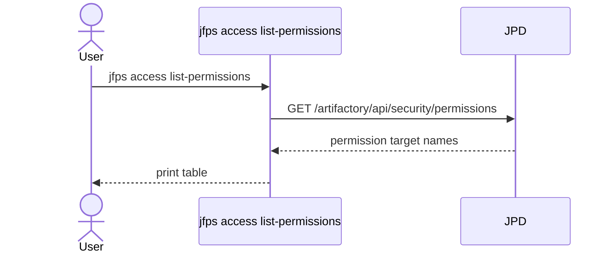

## `show-permission`

**What it does:** Shows one permission target's full detail (assigned repos + principals).

**Key flags:** `--name` (required)

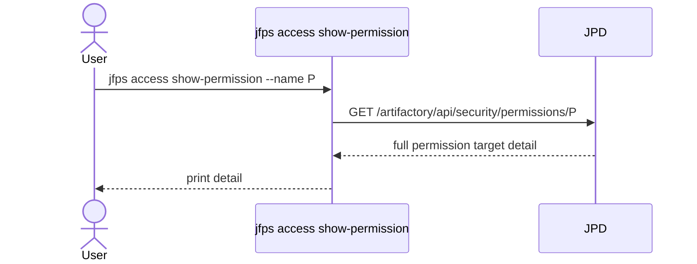

## `find-empty-permissions`

**What it does:** Finds permission targets with zero repositories assigned (excluding the built-in `INTERNAL` target).

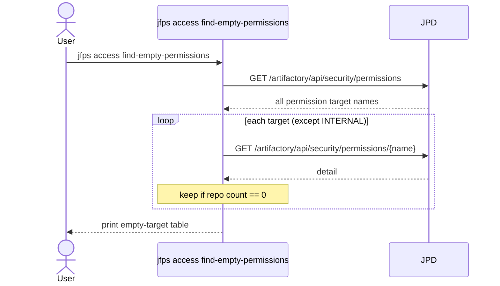

## `list-users-in-permission`

**What it does:** Lists usernames assigned to a permission target.

**Key flags:** `--name` (required)

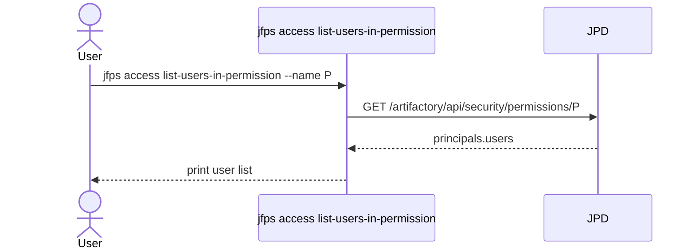

## `find-empty-groups`

**What it does:** Finds groups with no members.

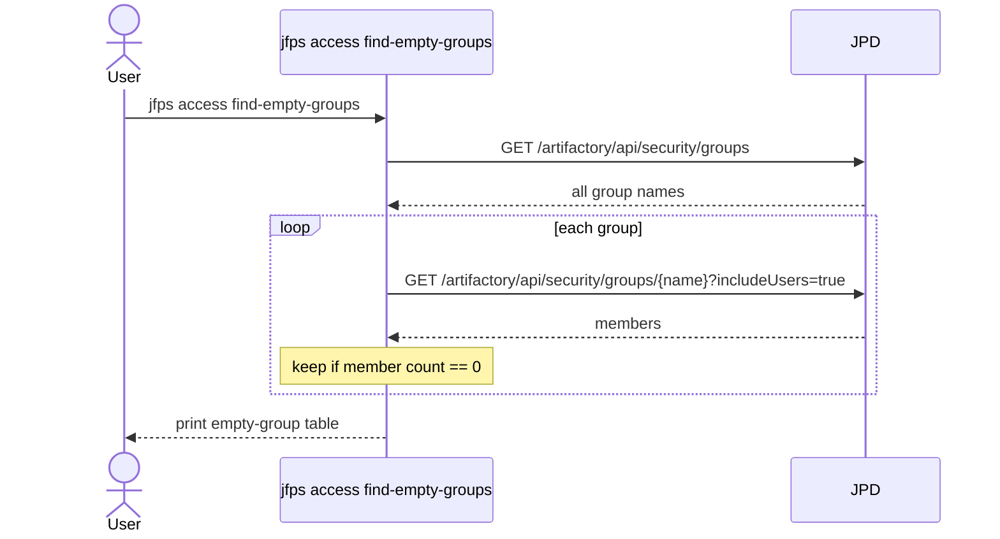

## `token-expiry`

**What it does:** Reports access tokens expiring within `--days` (or already expired). Non-expiring tokens (`expiry==0`) are always skipped.

**Key flags:** `--days` (default `30`)

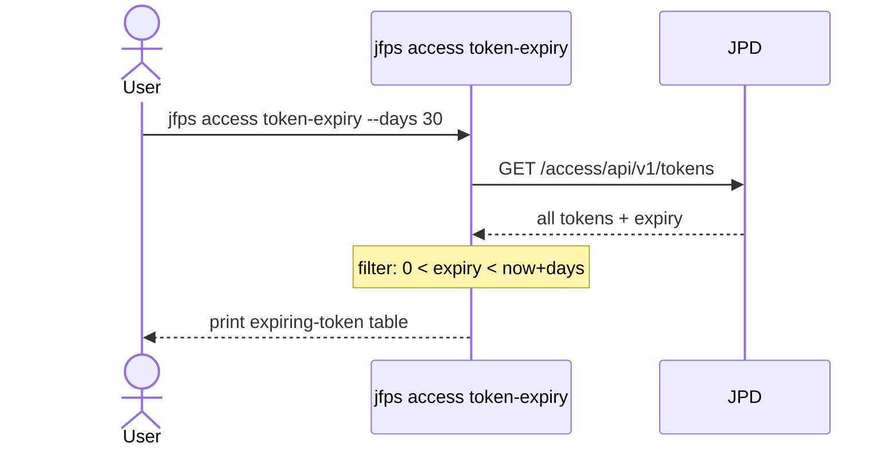

## `audit`

**What it does:** Finds v2 permission targets whose repo targets match a regex pattern, or a wildcard (`ANY`, `ANY LOCAL`, `ANY REMOTE`) scoped by `--repo-type`.

**Key flags:** `--repo-pattern` (required, regex), `--repo-type` (optional)

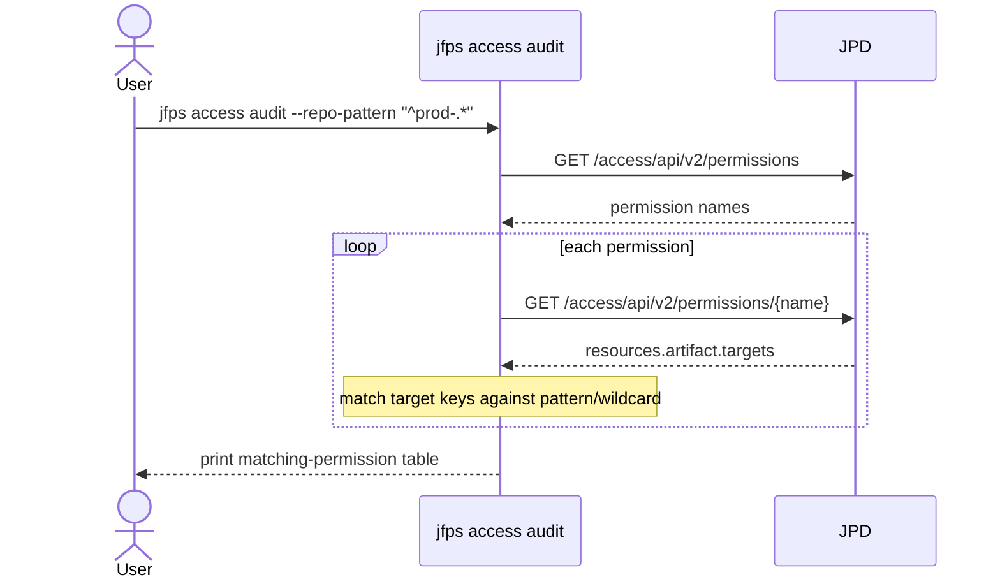

## `create-permission`

**What it does:** Creates a brand-new v2 permission target scoped to a set of repos, with no principals yet. Fails loudly if the name already exists (no dry-run — a create either succeeds or fails).

**Key flags:** `--name` (required), `--repos` (required, comma-separated)

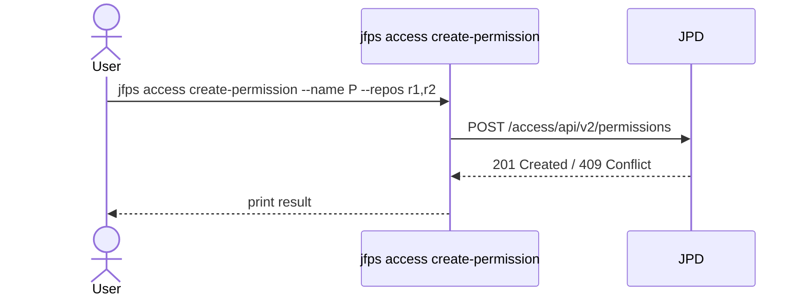

## `grant-path`

**What it does:** Idempotently creates a v2 permission target, or merges new repo/path/principal grants into an existing one.

**Key flags:** `--permission` (required), `--repos` (required), `--path` (required, `;`-separated include patterns), `--groups`/`--users` (optional `name:ACT+ACT` lists), `--resource` (default `artifact`), `--dry-run` (default `true`)

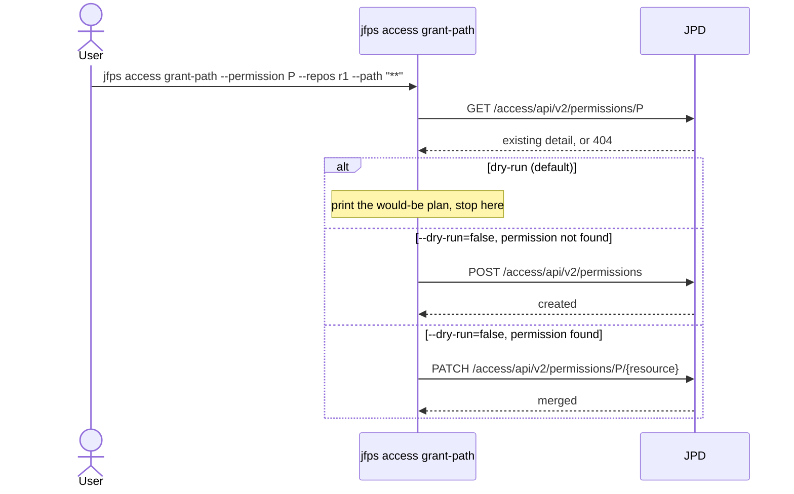

## `add-repos`

**What it does:** Adds repository keys to a permission target's `artifact` resource targets (no-op for repos already present).

**Key flags:** `--permission` (required), `--repos` (required), `--dry-run` (default `true`)

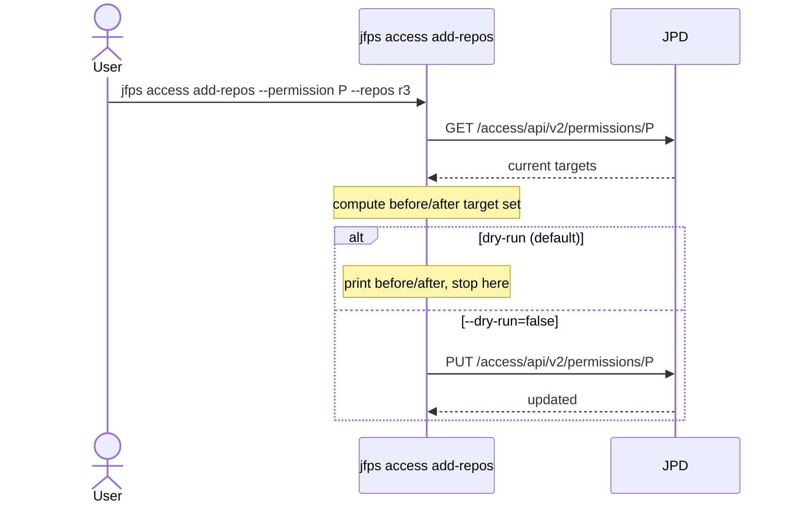

## `remove-repos`

**What it does:** Removes repository keys from a permission target's `artifact` resource targets, by exact key match (fixes a substring-match bug present in the legacy bash equivalent).

**Key flags:** `--permission` (required), `--repos` (required), `--dry-run` (default `true`)

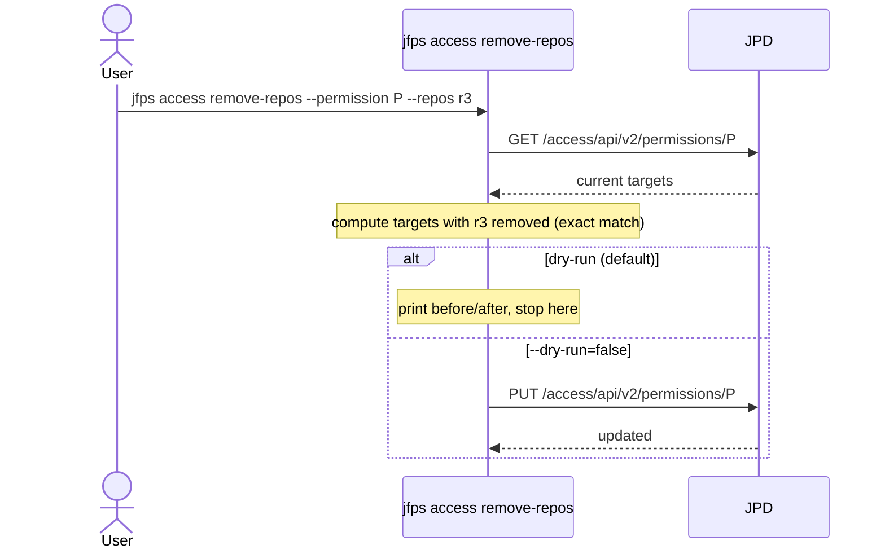

## `backup`

**What it does:** Exports users, groups, and/or permissions to local JSON files. Read-only against the server — only local files are written. `users.json`/`groups.json` each hold a JSON array of full per-user/per-group detail (not just names), and `permissions.json` a JSON array of full permission targets — this is the same file layout `restore` reads back in.

**Key flags:** `--output` (required, output directory), `--users-only`/`--groups-only`/`--permissions-only` (default: all three)

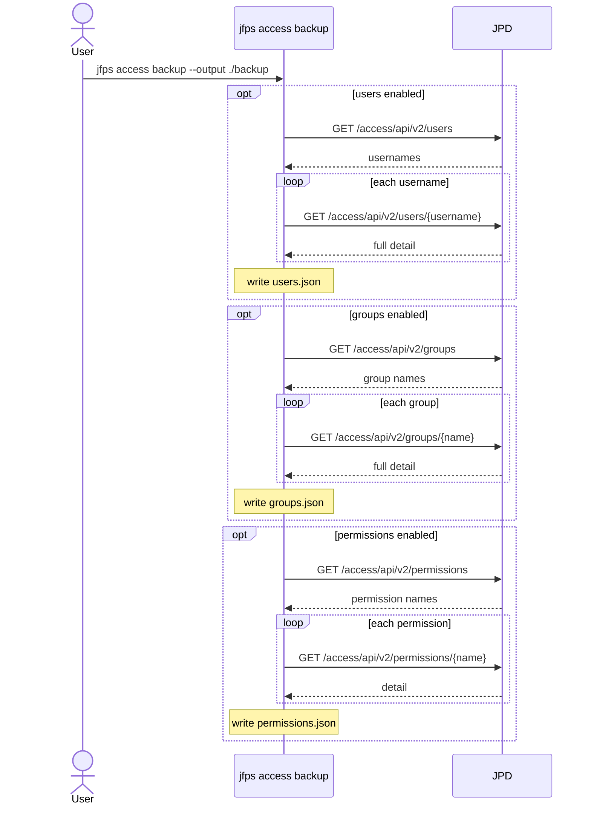

## `restore`

**What it does:** Reads a backup directory produced by `backup` and recreates on the target server whatever users, groups, and permissions from it don't already exist there (in that order, since groups reference users and permissions reference both). An entity that already exists on the target is always **skipped**, never updated or overwritten — this is a purely additive operation, useful for cloning identity/access setup onto a new JPD or merging one org's users/groups into another's.

Since a backup never carries a raw password (the Access API doesn't return one), every recreated user has `internal_password_disabled` forced to `true` regardless of its original realm — they'll need to authenticate via SSO or reset their password out of band.

**Key flags:** `--input` (required, a `backup` output directory), `--user-suffix`/`--group-suffix` (appended to every restored name, and to every user/group reference inside restored group memberships and permission principals — handy for merging two orgs' identities without name collisions), `--include-users`/`--include-groups`/`--include-permissions` (comma-separated original names; default: all), `--dry-run` (default `true`), `--yes`

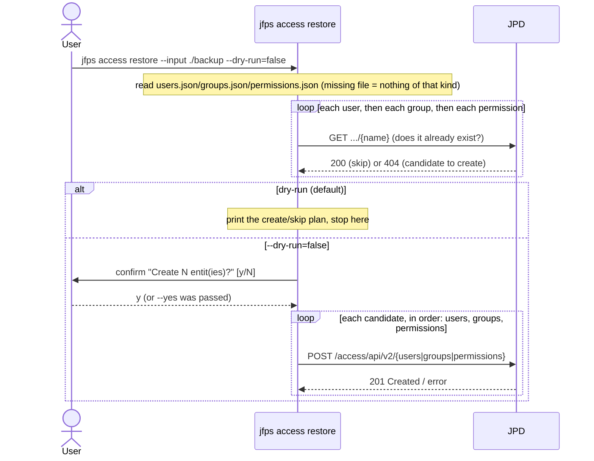

## `delete-users`

**What it does:** Bulk-deletes users listed (one per line) in a file, minus always-protected names (`admin`, `anonymous`) and anything in `--exclude`.

**Key flags:** `--file` (required), `--exclude` (comma-separated), `--dry-run` (default `true`), `--yes`

**Safety notes:** dry-run issues **zero** network calls at all (the candidate list is entirely local); when disabled, an interactive confirmation is also required unless `--yes` is passed.

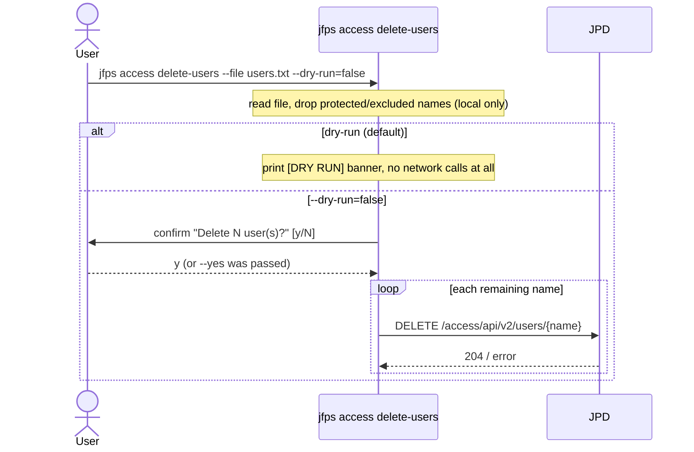

## `delete-groups`

**What it does:** Bulk-deletes groups listed in a file, minus always-protected names (`readers`, `Anyremote`, `admin`) and anything in `--exclude`. Same flow/flags/safety gates as `delete-users`, against `DELETE /access/api/v2/groups/{name}`.

## `delete-permissions`

**What it does:** Bulk-deletes permission targets listed in a file, minus always-protected names (`Any Remote`, `Anything`, `INTERNAL`) and anything in `--exclude`. Same flow/flags/safety gates as `delete-users`, against `DELETE /access/api/v2/permissions/{name}`.

## `effective-permissions`

**What it does:** For one or more repos, shows every user and group with any access to it and at what action level (`delete`/`deploy`/`annotate`/`read`/`distribute`/`managedXrayMeta`), plus which permission target(s) grant it. This is the inverse question from `audit` (which starts from a permission target and asks "which repos does it cover"); this instead starts from a repo and asks "who can touch it and how" — useful for answering an access-review question about one specific repository without having to manually cross-reference every permission target.

**Key flags:** `--repos` (required, comma-separated repo keys)

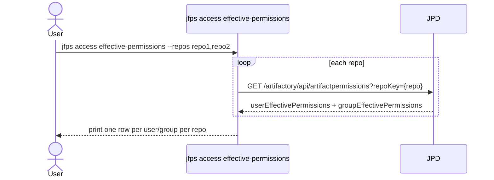
