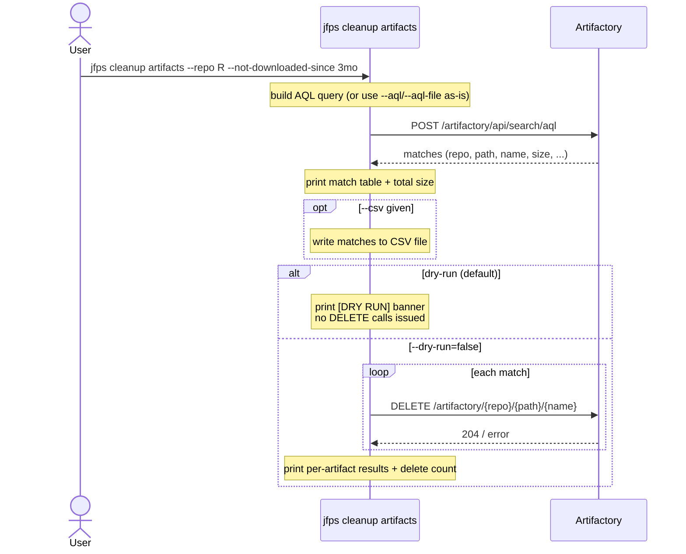
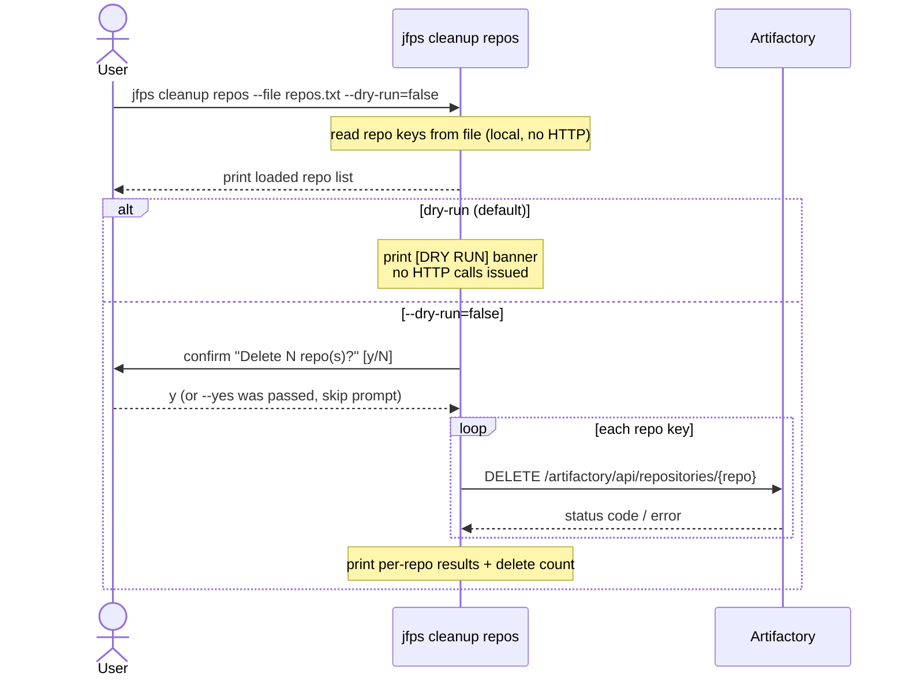
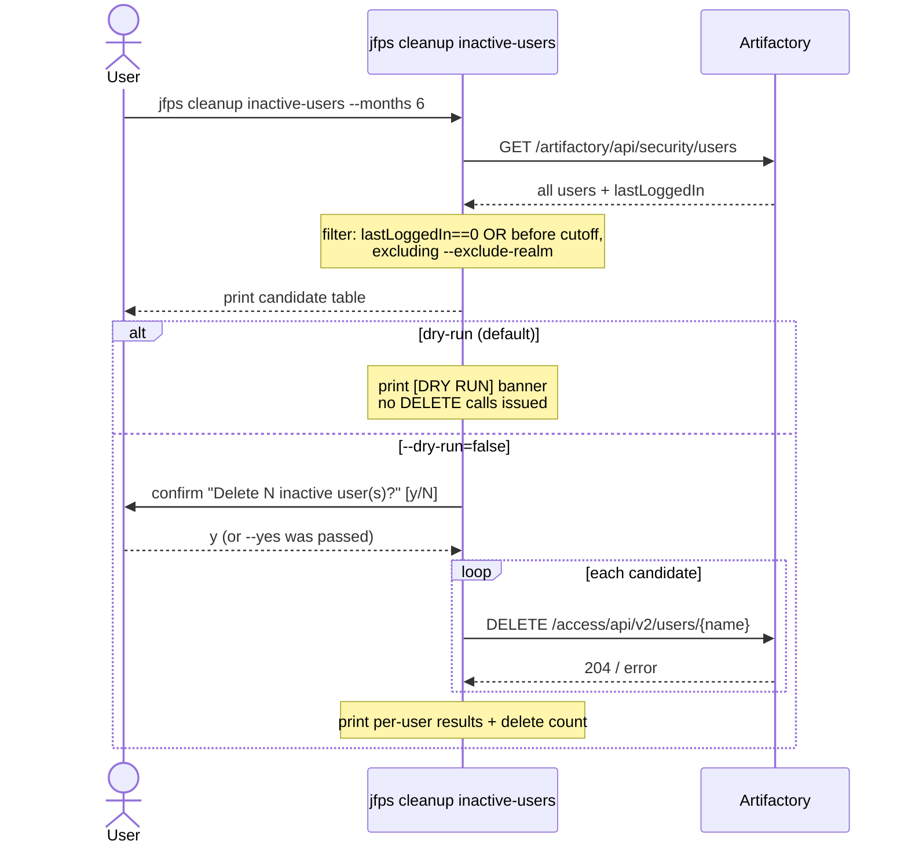
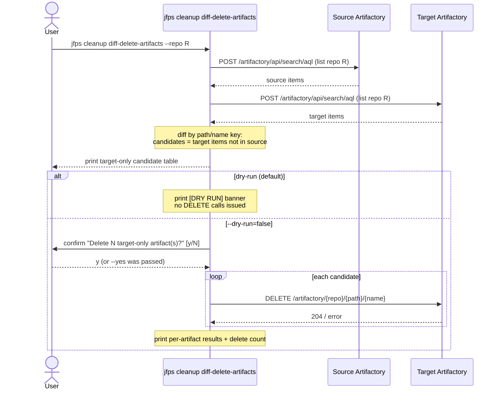
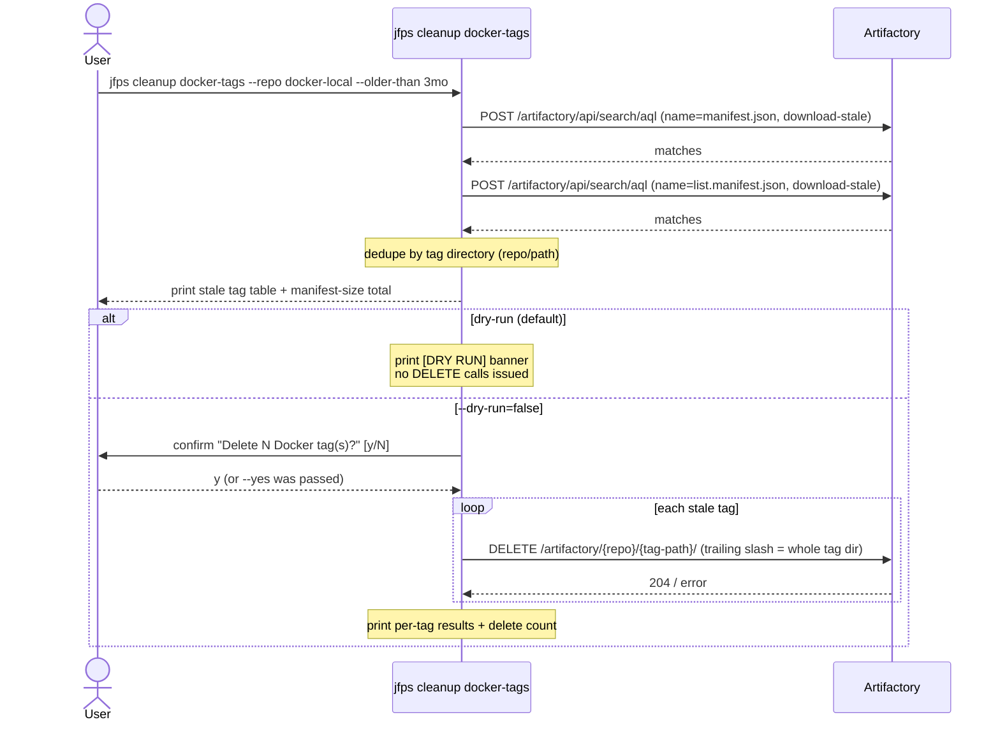
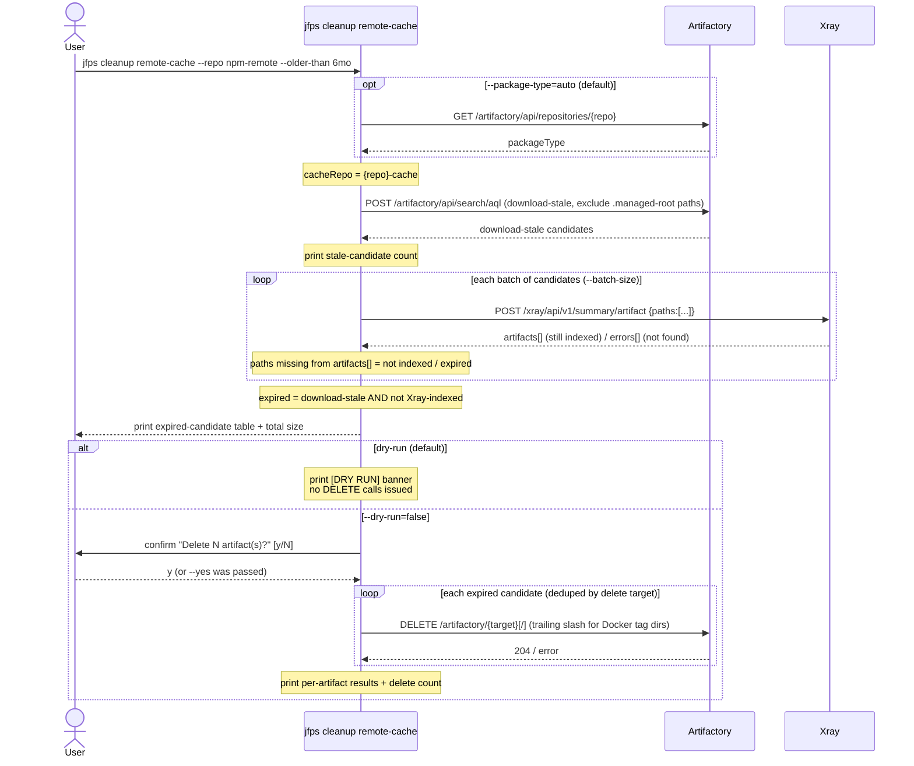

# `jfps cleanup`

Bulk-deletion and reconciliation commands: AQL-driven artifact deletion
(with built-in "not downloaded since" query building), bulk repository
deletion, inactive-user detection/removal, source-vs-target artifact
reconciliation, stale Docker/OCI tag cleanup, and remote-repository cache
cleanup gated on Xray index status.

**Safety model:** every subcommand here mutates state, and every one of them
defaults `--dry-run` to `true`. In dry-run mode, zero write calls (POST/PUT/
DELETE) are issued — only reads. The most destructive subcommands
(`repos`, `inactive-users`, `docker-tags`, `remote-cache`) additionally
require an interactive `y/N` confirmation once `--dry-run=false` is passed,
unless `--yes` is also given.

| Subcommand | What it does |
|---|---|
| [`artifacts`](#artifacts) | Delete artifacts matched by an AQL query (hand-written, or built from `--repo`/`--not-downloaded-since`) |
| [`repos`](#repos) | Delete repositories listed in a file |
| [`inactive-users`](#inactive-users) | Find/delete users inactive for N+ months |
| [`diff-delete-artifacts`](#diff-delete-artifacts) | Delete target-only artifacts so target matches source |
| [`docker-tags`](#docker-tags) | Delete stale Docker/OCI tags (the whole tag, not just `manifest.json`) |
| [`remote-cache`](#remote-cache) | Delete remote-cache artifacts that are download-stale **and** no longer Xray-indexed |

---

## `artifacts`

**What it does:** Runs an AQL query against one Artifactory server and
deletes every matching artifact. The query can be supplied directly
(`--aql`/`--aql-file`), or built for you from `--repo` + `--not-downloaded-since`
using the same "never downloaded, or not downloaded in N months" pattern
used throughout JFrog's documented cleanup recipes — so common cleanups
don't require hand-writing AQL. Always reports the total size of what
matched, before any deletion happens.

**Key flags:**
- `--aql` / `--aql-file` — a literal AQL query, or a path to a file containing one
- `--repo` + `--not-downloaded-since <duration>` — alternative to the above; `<duration>` is an AQL relative time like `3mo`, `6mo`, `1y`, `90d`
- `--csv <path>` — also write matches to CSV
- `--dry-run` (default `true`), no `--yes` gate (matches are only ever what the AQL query said, so there's no separate confirmation beyond re-running with `--dry-run=false`)

**Safety notes:** dry-run (default) issues zero DELETE calls; re-run with `--dry-run=false` to actually delete.

---

## `repos`

**What it does:** Bulk-deletes repositories whose keys are listed, one per
line, in a plain text file (blank lines and `#`-comments are skipped).

**Key flags:**
- `--file <path>` (required) — newline-delimited repo keys
- `--dry-run` (default `true`)
- `--yes` — skip the interactive confirmation prompt

**Safety notes:** dry-run skips *all* HTTP calls, not just the deletes. When disabling dry-run, an interactive `y/N` confirmation is also required unless `--yes` is passed — two independent gates before any repository is deleted.

---

## `inactive-users`

**What it does:** Finds Artifactory users who haven't logged in for at least
`--months` months (or never logged in at all), excluding a given realm
(default `internal`, to protect Artifactory's own service accounts), and
optionally deletes them.

**Key flags:**
- `--months` (default `6`) — inactivity threshold
- `--exclude-realm` (default `internal`) — realm to always skip
- `--dry-run` (default `true`)
- `--yes` — skip the interactive confirmation prompt

**Safety notes:** dry-run default; interactive confirmation required to actually delete unless `--yes` is passed.

---

## `diff-delete-artifacts`

**What it does:** Compares the same repository across two servers (source
and target) by path+name (or sha256), and deletes from **target only**
whatever exists there but not on source — i.e. brings target back in sync
with source by removing extras (never adds anything).

**Key flags:**
- `--repo` (required) — repo key to compare, same on both servers
- uses `--source-*`/`--target-*` connection flags
- `--dry-run` (default `true`)
- `--yes` — skip the interactive confirmation prompt

**Safety notes:** dry-run default; deletes only ever target the **target** server, never source; interactive confirmation required unless `--yes`.

---

## `docker-tags`

**What it does:** Finds Docker/OCI tags whose manifest (`manifest.json` or,
for multi-arch images, `list.manifest.json`) has not been downloaded, or
not downloaded in `--older-than`, and deletes the **whole tag directory** —
not just the manifest file. Deleting only the manifest is a well-documented
pitfall: the tag's config blob and layers are left behind as orphaned
storage. Matches on either manifest name are deduplicated to one delete per
tag directory.

**Key flags:**
- `--repo` (required) — Docker/OCI repository to search
- `--older-than <duration>` (required) — e.g. `3mo`, `6mo`, `1y`
- `--csv <path>` — also write matches to CSV
- `--dry-run` (default `true`)
- `--yes` — skip the interactive confirmation prompt

**Safety notes:** dry-run default; interactive confirmation required unless `--yes`; deletes the tag directory with a trailing slash, never the manifest file alone.

---

## `remote-cache`

**What it does:** Cleans up a remote repository's local cache
(`<remote>-cache`) using two filters in sequence, mirroring the PS "Xray
retention expired" cleanup pattern: first, find artifacts that are
download-stale (never downloaded, or not downloaded in `--older-than`);
then, of those, keep only the ones Xray no longer has an index record for
(never indexed, or the cache entry's Xray retention has expired) — an
artifact Xray still has indexed is left alone even if it's download-stale,
since Xray may still need it. Docker/OCI repos are detected automatically
(or forced via `--package-type`) and cleaned up by tag directory, same as
`docker-tags`.

**Key flags:**
- `--repo` (required) — the **remote** repo key, e.g. `npm-remote` (its `-cache` repo is what's actually searched)
- `--older-than` (default `6mo`)
- `--package-type` (default `auto`) — `auto` \| `docker` \| `other`
- `--batch-size` (default `50`) — paths per Xray Artifact Summary call
- `--csv <path>` — also write remaining candidates to CSV
- `--dry-run` (default `true`)
- `--yes` — skip the interactive confirmation prompt

**Safety notes:** dry-run default; interactive confirmation required unless `--yes`; an artifact still Xray-indexed is never deleted regardless of download staleness.

