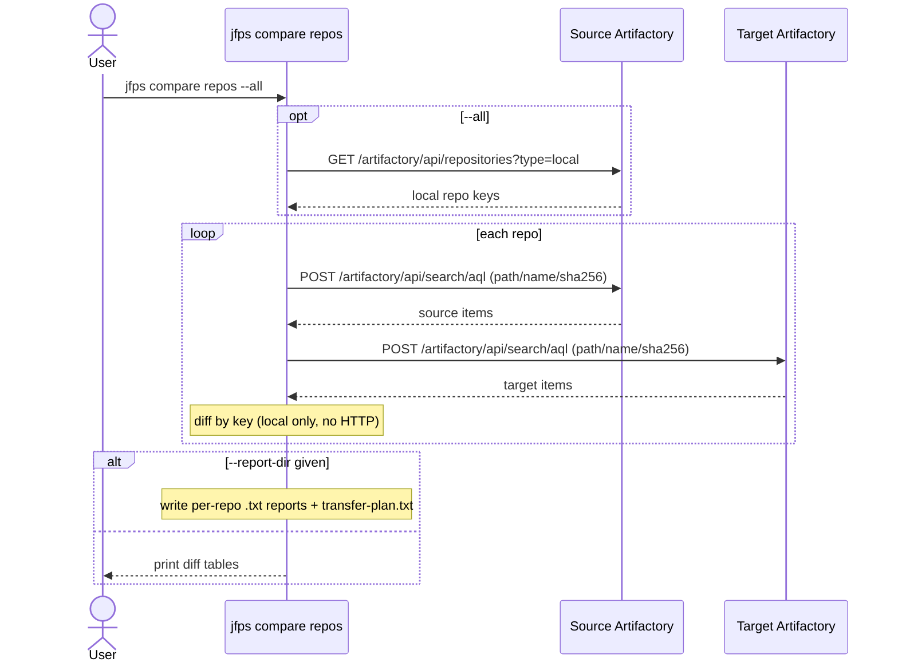
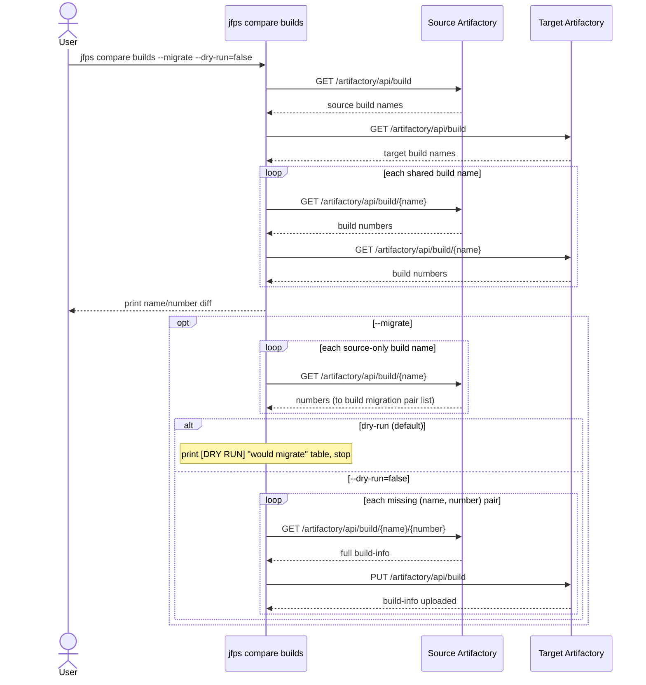
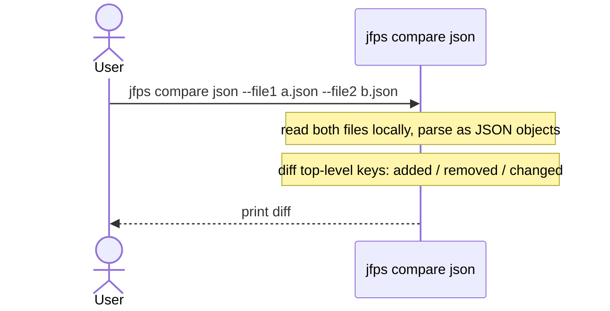

# `jfps compare`

Verifies migrations between two JPDs by diffing repository contents
(checksums), build-info (names/numbers, with optional migration), and
generic local JSON/config files.

**Safety model:** `repos` and `json` are strictly read-only (and `json`
isn't even server-connected). `builds` is read-only unless `--migrate
--dry-run=false` is passed together, in which case it uploads missing
build-info to target.

| Subcommand | What it does |
|---|---|
| [`repos`](#repos) | Compare artifact contents (checksums) between source and target |
| [`builds`](#builds) | Compare build names/numbers; optionally migrate missing ones |
| [`json`](#json) | Diff two local JSON files (no server involved) |

---

## `repos`

**What it does:** Compares artifact contents (path/name/sha256) of one or every local repo between a source and target JPD; source is treated as ground truth. Never modifies either server.

**Key flags:** `--repo`/`--all` (mutually exclusive), `--report-dir` (write per-repo `.txt` reports + `transfer-plan.txt` to disk instead of printing tables)

**Safety notes:** none (read-only)

---

## `builds`

**What it does:** Compares build names/numbers between source and target. With `--migrate`, additionally uploads build-info for pairs missing on target — gated behind `--dry-run` like every other mutating command in this CLI.

**Key flags:** `--migrate`, `--dry-run` (default `true`)

**Safety notes:** mutating only via `--migrate`; defaults to `--dry-run=true`, so no upload happens unless the user explicitly passes `--dry-run=false`. No interactive confirmation prompt.

---

## `json`

**What it does:** Diffs two local JSON object files (added/removed/changed top-level keys). No server involved at all — purely local file reads and comparison.

**Key flags:** `--file1`, `--file2`

**Safety notes:** none (read-only, not server-connected)

