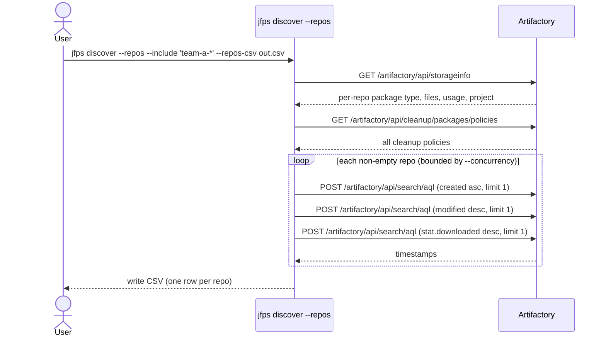
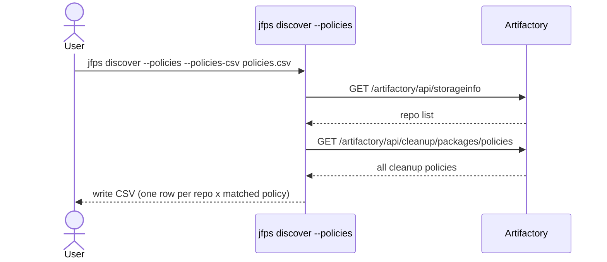
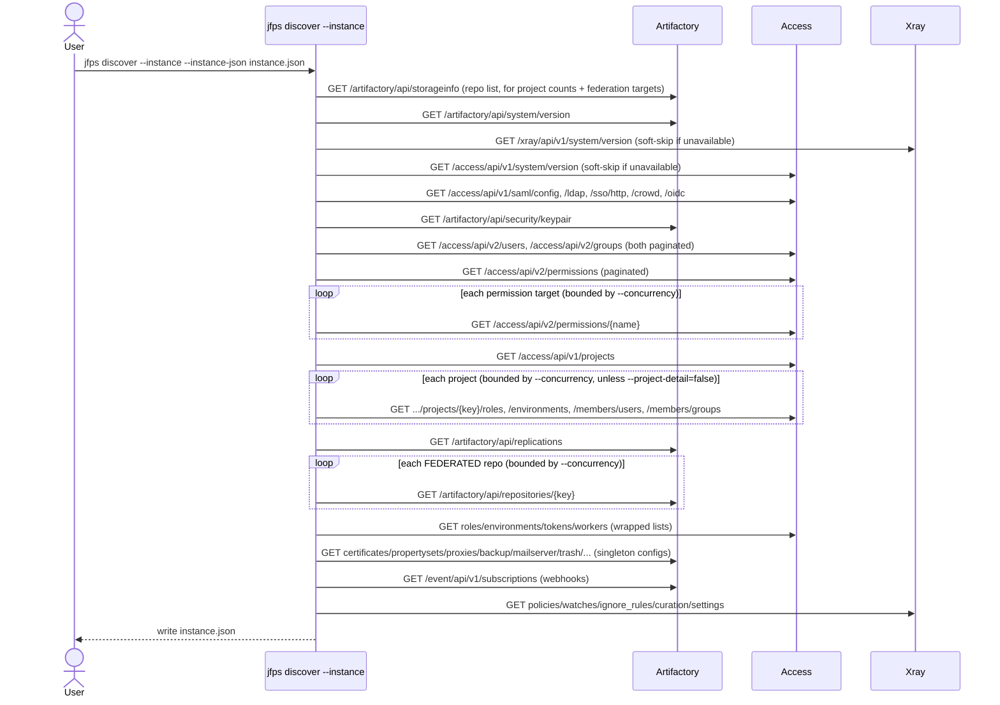
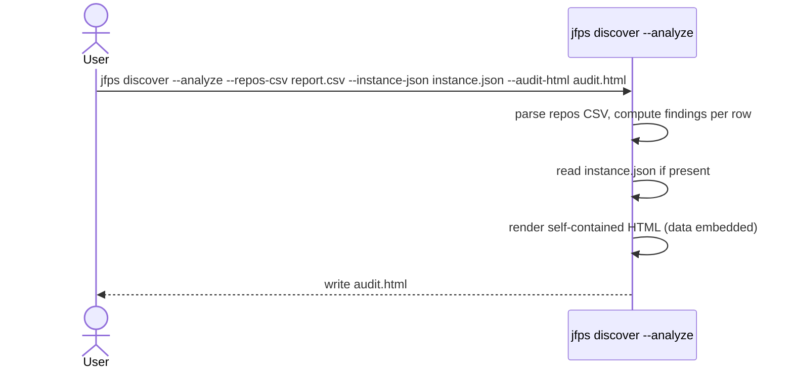

# `jfps discover`

Repo storage/activity/cleanup-policy/project reporting, instance-wide
discovery (versions, storage, auth/signing keys, users/groups/permissions,
projects, replication & federation, platform config, Xray policy/watch/
ignore-rule/curation config), and turning all of that into a self-contained
interactive HTML audit. Everything here is read-only — nothing it does ever
issues a write call to Artifactory; the analyze step makes no network calls
at all.

Unlike every other `jfps` command group, `discover` is **one command with
boolean selection flags**, not subcommands — so a single invocation can
generate the repo report, the instance snapshot, and the rendered HTML audit
together:

```sh
jfps discover --repos --instance --analyze --url ... --token ...
# or, shorthand for all four pieces:
jfps discover --all --url ... --token ...
```

Flags run in this fixed order regardless of the order you pass them:
**repos → policies → instance → analyze** — so `--analyze` in the same
invocation always picks up whatever `--repos`/`--instance` just wrote.

| Flag | What it does |
|---|---|
| [`--repos`](#--repos) | Per-repo package type, file count, usage, project assignment, created/last-push/last-pull, and matched cleanup-policy detail → `--repos-csv` |
| [`--policies`](#--policies) | Map every repo to its matching cleanup policy/policies (one row per repo × match) → `--policies-csv` |
| [`--instance`](#--instance) | Component versions, storage, auth/signing-key config, users/groups/permission-target access, projects, replication & federation, platform config, Xray config → `--instance-json` |
| [`--analyze`](#--analyze) | Turn `--repos-csv` (+ `--instance-json` if present) into a self-contained interactive HTML audit → `--audit-html` |
| `--all` | Shorthand for all four together |

Artifactory tracks neither a repo's own creation time nor a "last activity"
field, and has no reverse "which cleanup policy applies to this repo" or
"which policy applies to this project" lookup — `--repos`/`--policies`/
`--instance` derive these via AQL and client-side matching.

---

## `--repos`

**What it does:** Fetches every repo's package type, file count, usage, and
project assignment from `/api/storageinfo`, then (for non-empty repos,
concurrently) derives:

- `created_date` — proxy: creation time of the repo's oldest item
- `last_push_date` — proxy: modification time of the repo's newest item
- `last_pull_date` — most recent `stat.downloaded` across the repo's items
- `last_activity_date` — the later of the two above

and, by default, every matched cleanup policy's key, enabled state, cron
expression, and full retention criteria (days *and* months variants, plus
keep-last-N-versions) — `|`-joined when a repo matches more than one policy.

**Key flags:**
- `--repos-csv` (default `report.csv`) — output path
- `--concurrency` (default `8`) — repos processed in parallel; keep modest on shared instances
- `--cleanup-policies` (default `true`) — include the policy-detail columns (one extra API call)
- `--include` / `--exclude` — comma-separated glob patterns to scope a run

**Safety notes:** none (read-only). On a large/shared instance, scope with
`--include`/`--exclude` first — each non-empty repo costs 3 AQL calls.



---

## `--policies`

**What it does:** The same repo ↔ policy matching as `--repos`, but as one
row per repo × matched policy (or a blank-policy row when nothing matches) —
useful for spotting ambiguous or overlapping cleanup-policy coverage that a
single joined column would hide.

**Key flags:** `--policies-csv` (default `policies.csv`) — output path

**Safety notes:** none (read-only, no AQL calls — just the two list endpoints)



---

## `--instance`

**What it does:** Collects instance-wide state that isn't per-repo:

- **Component versions** — Artifactory (required), Xray/Access/Distribution
  (soft-skipped as "not available" on a 404/403/5xx, e.g. unlicensed or not installed)
- **Storage summary** — from `/api/storageinfo`'s `binariesSummary`/`fileStoreSummary`
- **Authentication** — whether SAML, LDAP, HTTP SSO, and/or Crowd are
  configured, and every configured OIDC identity provider
- **Repository signing keys** — pair name/type/alias only, **never key
  material** (public or private) — flagged prominently in `--analyze`'s output
  when any exist
- **Users** and **groups** (paginated via the Access API's cursor)
- **Permission targets** — repo scope plus user/group grants, fetched
  concurrently per target
- **Projects** — repo count cross-referenced from the repo list, plus (unless
  `--project-detail=false`) each project's roles, environments, and
  (opportunistically — this 404s on at least some JFrog SaaS tiers) member
  users/groups
- **Replication configs** — one bulk call, no per-repo lookup needed
- **Federated repos' member config** — fetched per federated repo (no bulk
  endpoint exists for this), concurrently
- **Platform config** — global roles/environments, scoped tokens (metadata
  only, never the token secret), certificates (metadata only, never the PEM),
  property sets, proxies, backups, mail server/trash/password/lock-policy/
  repo-layout/reverse-proxy config, archive cleanup policies, license
  (type/licensee/validity — never the license hash), workers (never the
  worker source code), webhooks (never the signing secret)
- **Xray config** — policies, watches, ignore rules, curation policies,
  system settings — zero-valued entirely if Xray isn't licensed

Only the Artifactory version fetch is fatal; everything else soft-fails into
the output's `warnings` array so one broken/unlicensed endpoint doesn't blank
out the rest of the snapshot. Per-project role/environment/member fetches are
the one exception — those soft-skip *silently* (no warning) since at
hundreds of projects, a routinely-404 sub-endpoint would otherwise flood the
report with near-duplicate lines.

**Key flags:**
- `--instance-json` (default `instance.json`) — output path
- `--concurrency` (default `8`) — permission-target/federated-repo/project-detail fetches
- `--max-users` / `--max-groups` / `--max-permissions` (defaults `5000`/`5000`/`2000`) — caps with an explicit truncation warning if hit, never a silent one
- `--project-detail` (default `true`) — fetch each project's roles/environments/members too (2-4 extra calls per project; disable on an instance with a very large number of projects)

**Progress:** each concurrent-bounded stage (permission targets, project
detail, federated repos - and `--repos`' own AQL sweep) prints a live text
progress bar to stderr (`Permissions      [###-------] 15% (6/40)`), no
external dependency. A stage with nothing to do (e.g. no federated repos on
this instance) is skipped silently rather than printing an empty bar.

**Safety notes:** none (read-only).



---

## `--analyze`

**What it does:** Reads `--repos-csv` (from this environment or any other —
this step never talks to Artifactory), optionally plus `--instance-json`, and
writes one self-contained HTML file. All data is embedded in the HTML.

With just a repos CSV, the report is a single "Repos" view: summary stats,
clickable findings, and a searchable/filterable repo explorer with a per-repo
detail drawer.

An instance snapshot adds eight more tabs:
- **All Findings** — every flagged resource, of any type, in one searchable
  table: `resource_type`, `resource_name`, `finding`, `detail`. Combines the
  Repos tab's per-repo findings with new cross-resource findings:
  `no-principals`/`wildcard-scope` (permission targets), `empty-project`
  (no repos/roles/members), `single-member` (a federated repo with fewer
  than 2 enabled members), `disabled` (a configured-but-disabled
  replication), `non-expiring` (a scoped token with no expiry — a common
  access-review finding), `inactive` (an Xray watch that's configured but
  not active), `no-rules` (an Xray policy with no rules, so it can't act
  even if assigned to a watch). This is the tab to open first for "what's
  wrong across the whole environment."
- **Overview** — component versions, storage summary, authentication methods,
  and a highlighted callout for repository signing keys if any are configured
- **Access** — searchable Users, Groups, and Permission Targets tables (the
  last showing repo scope plus user/group grants)
- **Projects** — searchable table with each project's repo count (cross-reference
  against the Repos tab's `project_key` column to see exactly which repos —
  including ones with no project, `project_key` `"default"` — belong where);
  click a row to see that project's roles/environments/members in full
- **Relationships** — a project-to-repo view: pick "Global" or a project from
  the dropdown (a search box beside it narrows the project list, since an
  instance can have hundreds) and see that project's repos; anything with no
  project shows up under Global. A small hub-and-spoke SVG diagram shows up
  to 24 connections at a glance; the searchable table below it always has
  the full list. This is the direct answer to "which repos belong to this
  project" — the Projects tab's row-click drawer shows the same repo list as
  raw JSON, this tab is the visual/browsable version of it
- **Federation & Replication** — federated repos' member config, and every
  configured replication
- **Platform Config** — global roles/environments/tokens, certificates,
  property sets, proxies, backups, archive cleanup policies, workers,
  webhooks, plus singleton config (mail server, password/lockout policy,
  reverse proxy, license, trash retention)
- **Xray** — policies, watches, ignore rules, curation policies, and system
  settings (shows a plain notice instead if Xray isn't licensed)

Findings on the Repos tab: `empty` (zero files), `stale` (no push/pull inside
`--stale-days`, or none recorded despite having files), `huge` /
`massive-files` (over `--huge-gb` / `--massive-files`), `naming-nonconformant`
/ `uppercase` / `underscore` / `very-long-name` (lowercase-hyphen key
hygiene), `no-cleanup-policy` (no policy's scope matches), `multi-policy-match`
(more than one policy's scope overlaps — worth confirming that's
intentional). A finding whose source column is missing from the repos CSV
(e.g. after `--repos --cleanup-policies=false`) is skipped rather than
mis-flagged.

**Key flags:**
- `--repos-csv` (default `report.csv`) — input; errors clearly if missing
- `--instance-json` (default `instance.json`) — input if present, silently skipped (repos-only report) if not
- `--audit-html` (default `audit.html`) — output path
- `--stale-days` (default `180`), `--huge-gb` (default `500`),
  `--massive-files` (default `500000`), `--long-name-chars` (default `40`)

**Safety notes:** none — this step makes no network calls at all.


