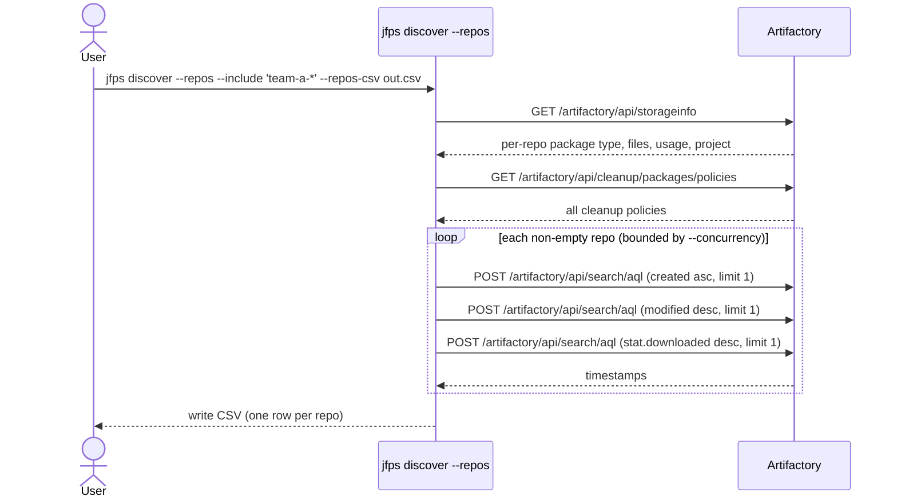
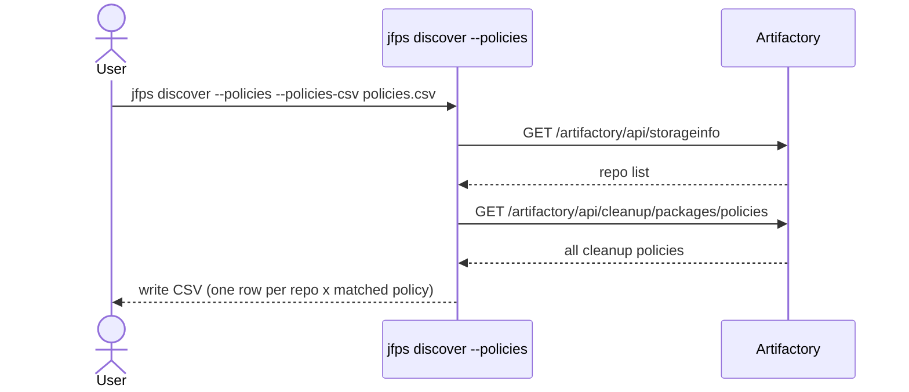
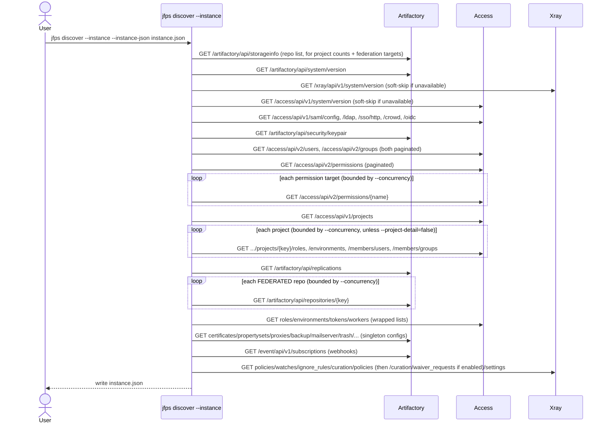
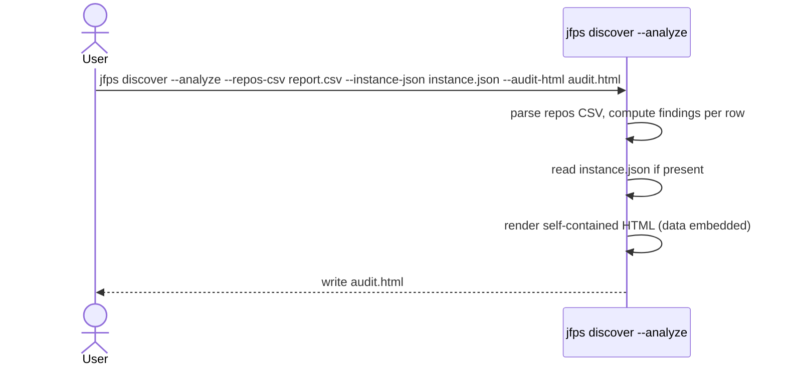

# `jfps discover`

Repo storage/activity/cleanup-policy/project reporting, instance-wide
discovery (versions, storage, auth/signing keys, users/groups/permissions,
projects, replication & federation, platform config, Xray policy/watch/
ignore-rule/curation config), and turning all of that into a self-contained
interactive HTML audit. Everything here is read-only — nothing it does ever
issues a write call to Artifactory; the analyze step makes no network calls
at all.

Unlike every other `jfps` command group, `discover` is **one command with
boolean selection flags**, not subcommands — so a single invocation can
generate the repo report, the instance snapshot, and the rendered HTML audit
together:

```sh
jfps discover --repos --instance --analyze --url ... --token ...
# or, shorthand for all four pieces:
jfps discover --all --url ... --token ...
```

Flags run in this fixed order regardless of the order you pass them:
**repos → policies → instance → analyze** — so `--analyze` in the same
invocation always picks up whatever `--repos`/`--instance` just wrote.

| Flag | What it does |
|---|---|
| [`--repos`](#--repos) | Per-repo package type, file count, usage, project assignment, created/last-push/last-pull, and matched cleanup-policy detail → `--repos-csv` |
| [`--policies`](#--policies) | Map every repo to its matching cleanup policy/policies (one row per repo × match) → `--policies-csv` |
| [`--instance`](#--instance) | Component versions, storage, auth/signing-key config, users/groups/permission-target access, projects, replication & federation, platform config, Xray config → `--instance-json` |
| [`--project-roles`](#--project-roles) | List all project roles (one row per project × role combination) → `--project-roles-csv` |
| [`--project-repos`](#--project-repos) | List all project-to-repository mappings with package type and repo type → `--project-repos-csv` |
| [`--apptrust`](#--apptrust) | AppTrust applications, policies, rules, templates, lifecycle stages, evidence, and release bundles (collected as part of `--instance`) |
| [`--analyze`](#--analyze) | Turn `--repos-csv` (+ `--instance-json` if present) into a self-contained interactive HTML audit → `--audit-html` |
| [`--cross-env-analyze`](#--cross-env-analyze) | Scan the `--output` directory for discovery outputs from multiple environments and report duplicate repositories across environments → `--cross-env-report` |
| `--all` | Comprehensive discovery: --repos --policies --instance --project-roles --project-repos --apptrust --analyze |

**Output paths:** `--repos-csv`/`--policies-csv`/`--instance-json`/`--audit-html`
each default to a path under `--output` (default `output`), in a subfolder
named after the JPD's hostname prefix — e.g. `jfps discover --all --url
https://psazuse.jfrog.io ...` writes `output/psazuse/report.csv`,
`output/psazuse/policies.csv`, `output/psazuse/instance.json`, and
`output/psazuse/audit.html`. This keeps repeated runs against different
instances from overwriting each other's reports. Passing any of the four
path flags explicitly overrides that default entirely for that one file
(ignoring `--output`), so `--repos-csv myreport.csv` still just writes
`myreport.csv` in the current directory, exactly as before. A bare IP host
(no dot-separated hostname to take a prefix from) uses the full IP instead;
if no URL is configured at all (e.g. an `--analyze`-only run with no
`--url`/`--server`/env var), the subfolder is named `default`.

**Concurrency:** `--repos`, `--policies`, and `--instance` run concurrently
by default whenever more than one is selected (e.g. `--all`) — they're
independent network calls against the same JPD, so this meaningfully cuts
total run time. Live `\r`-based progress bars are suppressed while running
concurrently (multiple bars updating the same terminal line at once would
garble it); pass `--parallel=false` to run them one at a time instead, with
full progress bars restored. `--analyze` always runs last regardless, since
it depends on the others' output.

Artifactory tracks neither a repo's own creation time nor a "last activity"
field, and has no reverse "which cleanup policy applies to this repo" or
"which policy applies to this project" lookup — `--repos`/`--policies`/
`--instance` derive these via AQL and client-side matching.

**Error handling:** nothing here ever aborts the run. A broken/unlicensed
endpoint - even a transient 5xx on the very first call `--repos`/`--instance`
make - is logged and the affected piece is skipped (its output file simply
isn't written) rather than failing the whole invocation, so `--all` still
gets you everything that *could* be collected. Every such error is
summarized to stderr once, at the end of the run:

```
Discovery completed with 1 error(s) (continuing rather than aborting):
  - instance: fetch storageinfo: HTTP 500: ...
```

The only genuine failures are usage errors that mean there's nothing to do
at all: bad flags, unresolvable connection credentials, or `--analyze` with
neither a repos CSV nor an instance JSON to read.

---

## `--repos`

**What it does:** Fetches every repo's package type, file count, usage, and
project assignment from `/api/storageinfo`, then (for non-empty repos,
concurrently) derives:

- `created_date` / `created_by` — proxy: creation time (and creating
  account) of the repo's oldest item
- `last_push_date` / `last_push_by` — proxy: modification time (and
  modifying account) of the repo's newest item
- `last_pull_date` — most recent `stat.downloaded` across the repo's items
- `last_activity_date` — the later of the two dates above

The `_by` columns are useful for spotting a repo created or modified by an
unexpected account - both are also shown as their own columns in
`--analyze`'s Repos tab, not just buried in the per-repo detail drawer.

and, by default, every matched cleanup policy's key, enabled state, cron
expression, and full retention criteria (days *and* months variants, plus
keep-last-N-versions) — `|`-joined when a repo matches more than one policy.

**Key flags:**
- `--repos-csv` (default `<output>/<instance>/report.csv`, see "Output paths" above) — output path
- `--concurrency` (default `8`) — repos processed in parallel; keep modest on shared instances
- `--cleanup-policies` (default `true`) — include the policy-detail columns (one extra API call)
- `--include` / `--exclude` — comma-separated glob patterns to scope a run

**Safety notes:** none (read-only). On a large/shared instance, scope with
`--include`/`--exclude` first — each non-empty repo costs 3 AQL calls.



---

## `--policies`

**What it does:** The same repo ↔ policy matching as `--repos`, but as one
row per repo × matched policy (or a blank-policy row when nothing matches) —
useful for spotting ambiguous or overlapping cleanup-policy coverage that a
single joined column would hide.

**Key flags:** `--policies-csv` (default `<output>/<instance>/policies.csv`, see "Output paths" above) — output path

**Safety notes:** none (read-only, no AQL calls — just the two list endpoints)



---

## `--instance`

**What it does:** Collects instance-wide state that isn't per-repo:

- **Component versions** — Artifactory (required), Xray/Access/Distribution
  (soft-skipped as "not available" on a 404/403/5xx, e.g. unlicensed or not installed)
- **Storage summary** — from `/api/storageinfo`'s `binariesSummary`/`fileStoreSummary`
- **Authentication** — whether SAML, LDAP, HTTP SSO, and/or Crowd are
  configured, and every configured OIDC identity provider
- **Repository signing keys** — pair name/type/alias only, **never key
  material** (public or private) — flagged prominently in `--analyze`'s output
  when any exist
- **Users** and **groups** (paginated via the Access API's cursor)
- **Permission targets** — repo scope plus user/group grants, fetched
  concurrently per target
- **Projects** — repo count cross-referenced from the repo list, plus (unless
  `--project-detail=false`) each project's roles, environments, and
  (opportunistically — this 404s on at least some JFrog SaaS tiers) member
  users/groups
- **Replication configs** — one bulk call, no per-repo lookup needed
- **Federated repos' member config** — fetched per federated repo (no bulk
  endpoint exists for this), concurrently. `--analyze` computes a Status per
  repo from this (Healthy / Degraded / Single member / No members) — there's
  no dedicated Artifactory "federation status" endpoint, so this is derived
  client-side the same way the `single-member` finding always has been
- **Platform config** — global roles/environments, scoped tokens (subject/
  account, issued/expiry dates, scope — metadata only, never the token
  secret), certificates (metadata only, never the PEM), property sets,
  proxies, backups, mail server/trash/password/lock-policy/repo-layout/
  reverse-proxy config, archive cleanup policies, license (type/licensee/
  validity — never the license hash), workers (never the worker source
  code), webhooks (never the signing secret)
- **Xray config** — policies, watches, ignore rules, curation policies and
  waivers (only fetched if curation is actually enabled/available — a 404
  on the policies list means "not enabled," not "enabled with zero
  policies"), system settings — zero-valued entirely if Xray isn't licensed

Only the Artifactory version fetch is fatal; everything else soft-fails into
the output's `warnings` array so one broken/unlicensed endpoint doesn't blank
out the rest of the snapshot. Per-project role/environment/member fetches are
the one exception — those soft-skip *silently* (no warning) since at
hundreds of projects, a routinely-404 sub-endpoint would otherwise flood the
report with near-duplicate lines.

**Key flags:**
- `--instance-json` (default `<output>/<instance>/instance.json`, see "Output paths" above) — output path
- `--concurrency` (default `8`) — permission-target/federated-repo/project-detail fetches
- `--max-users` / `--max-groups` / `--max-permissions` (defaults `5000`/`5000`/`2000`) — caps with an explicit truncation warning if hit, never a silent one
- `--project-detail` (default `true`) — fetch each project's roles/environments/members too (2-4 extra calls per project; disable on an instance with a very large number of projects)

**Progress:** each concurrent-bounded stage (permission targets, project
detail, federated repos - and `--repos`' own AQL sweep) prints a live text
progress bar to stderr (`Permissions      [###-------] 15% (6/40)`), no
external dependency. A stage with nothing to do (e.g. no federated repos on
this instance) is skipped silently rather than printing an empty bar.

**Safety notes:** none (read-only).



---

## `--analyze`

**What it does:** Reads `--repos-csv` and/or `--instance-json` (from this
environment or any other — this step never talks to Artifactory) and writes
one self-contained HTML file. All data is embedded in the HTML. Either input
alone is enough to render a report - e.g. running just `discover --instance`
(no `--repos`) and then `--analyze` still produces a full report with
Overview/Access/Projects/Federation/Platform/Xray tabs, just with an empty
Repos tab. Only having *neither* file is an error.

With just a repos CSV, the report is a single "Repos" view: summary stats,
clickable findings, and a searchable/filterable repo explorer with a per-repo
detail drawer. Besides the free-text search and repo-type tabs, the toolbar
has a package-type filter, a date-range filter (pick which date column -
Created, Last push, Last pull, or Last activity - then a from/to range), and
a project filter - the last one only appears if the environment actually
uses Projects (see the Project column note below), so it's never shown as a
dead control on an instance that doesn't use the feature.

The table's **Project** column works the same way: it's only shown once at
least one repo's `project_key` is a real project (not blank/`"default"`) -
an environment that doesn't use Projects at all never gets a column that
would just say "default" on every row. This is a client-side check against
the embedded row data, so it works whether or not `--instance-json` was
even provided.

An instance snapshot adds nine more tabs, in this order - Overview (the
default active tab whenever one is present; Repos is the default only
without instance data), then Repos, Projects, Access, Federation &
Replication, Platform Config, Xray, Curation, All Findings, Relationships.
The instance's URL is also shown top-right in the report header (linking to
the real JPD) whenever instance data is present.
- **Overview** — the instance's name and URL, component versions, storage
  summary, an "Environment counts" section (projects, repositories, users,
  groups, permission targets, federated repos, replication configs, global
  roles - the instance's shape at a glance), authentication methods, a
  highlighted callout for repository signing keys if any are configured, and
  an **Anonymous access** callout (see below)
- **Projects** — searchable table with each project's repo count (cross-reference
  against the Repos tab's `project_key` column to see exactly which repos —
  including ones with no project, `project_key` `"default"` — belong where);
  click a row to see that project's repos, roles, environments, and members
  in full
- **Access** — searchable Users, Groups, and Permission Targets (repo scope
  plus user/group grants) tables, a **Repo access by user/group** table (see
  below), and Scoped Tokens (grouped by account/subject, with issued/expiry
  rendered as dates rather than raw unix timestamps)
- **Federation & Replication** — federated repos' member config plus a
  computed Status (Healthy / Degraded / Single member / No members
  configured, based on how many members are enabled), and every configured
  replication
- **Platform Config** — global roles/environments, certificates, signing
  keys (pair name, type, alias only - never key material), property sets,
  proxies, backups, archive cleanup policies, workers, webhooks, plus
  singleton config (mail server, password/lockout policy, reverse proxy,
  license, trash retention)
- **Xray** — policies, watches, ignore rules, and system settings (shows a
  plain notice instead if Xray isn't licensed)
- **Curation** — its own tab, separate from Xray, since curation is an
  independently-licensed feature: curation policies and waivers, with a
  plain notice instead if curation itself isn't enabled/available on this
  instance
- **All Findings** — every flagged resource, of any type, in one searchable
  table: `resource_type`, `resource_name`, `finding`, `detail`. Combines the
  Repos tab's per-repo findings with new cross-resource findings:
  `no-principals`/`wildcard-scope`/`anonymous-access` (permission targets),
  `empty-project` (no repos/roles/members), `single-member` (a federated
  repo with fewer than 2 enabled members), `disabled` (a
  configured-but-disabled replication), `non-expiring` (a scoped token with
  no expiry — a common access-review finding), `inactive` (an Xray watch
  that's configured but not active), `no-rules` (an Xray policy with no
  rules, so it can't act even if assigned to a watch). This is the tab to
  open first for "what's wrong across the whole environment."

**Anonymous access and per-user/per-repo access:** Artifactory has no
dedicated "is anonymous access enabled" REST endpoint — it implements the
"Allow Anonymous Access" toggle as permission-target grants to a built-in
`anonymous` user, so that's what's scanned for instead, purely from data
`--instance` already collects (no extra API calls): the Overview tab shows
a callout naming every repo pattern the anonymous user is granted on (or an
OK notice if there are none), each such grant also shows up as an
`anonymous-access` finding on the All Findings tab, and the Access tab's
**Repo access by user/group** table inverts every permission target's
`Repos` × `UserActions`/`GroupActions` into one row per principal × repo ×
permission target — search it for a username (or "anonymous") to see every
repo they can reach and what they can do there. A group row shows the
group's own grant, not its resolved members — group membership isn't
collected by `--instance`, so resolving a group grant down to individual
users isn't possible from this data alone.
- **Relationships** — a project-to-repo view: pick "Global" or a project from
  the dropdown (a search box beside it narrows the project list, since an
  instance can have hundreds) and see that project's repos; anything with no
  project shows up under Global. A small hub-and-spoke SVG diagram shows up
  to 24 connections at a glance; the searchable table below it always has
  the full list. This is the direct answer to "which repos belong to this
  project" — the Projects tab's row-click drawer shows the same repo list as
  raw JSON, this tab is the visual/browsable version of it

Findings on the Repos tab: `empty` (zero files), `stale` (no push/pull inside
`--stale-days`, or none recorded despite having files), `huge` /
`massive-files` (over `--huge-gb` / `--massive-files`), `naming-nonconformant`
/ `uppercase` / `underscore` / `very-long-name` (lowercase-hyphen key
hygiene), `no-cleanup-policy` (no policy's scope matches), `multi-policy-match`
(more than one policy's scope overlaps — worth confirming that's
intentional). A finding whose source column is missing from the repos CSV
(e.g. after `--repos --cleanup-policies=false`) is skipped rather than
mis-flagged.

**Key flags:**
- `--repos-csv` (default `<output>/<instance>/report.csv`, see "Output paths" above) — input if present, silently skipped (instance-only report) if not
- `--instance-json` (default `<output>/<instance>/instance.json`, see "Output paths" above) — input if present, silently skipped (repos-only report) if not; an error only if *neither* input exists
- `--audit-html` (default `<output>/<instance>/audit.html`, see "Output paths" above) — output path
- `--stale-days` (default `180`), `--huge-gb` (default `500`),
  `--massive-files` (default `500000`), `--long-name-chars` (default `40`)

**Safety notes:** none — this step makes no network calls at all.



---

## `--cross-env-analyze`

**What it does:** Scans the `--output` directory (or a custom path) for discovery outputs from multiple environments and generates a unified report identifying repositories that exist in more than one environment.

This is useful for:
- **Configuration audits** - Find repos with the same name but different configurations across environments
- **Compliance & governance** - Identify duplicate repos that might violate organizational policies
- **Migration planning** - Validate which repos should be replicated or consolidated
- **Disaster recovery** - Confirm backup/DR strategies and replication setup

**Key flags:**
- `--cross-env-report` (default `<output>/cross-env-analysis.txt`) — base path for the reports (automatically generates `.txt`, `.json`, and `.html` versions)
- `--output` (default `output`) — path to scan for multiple environment directories

**Output files:** Three complementary formats with the same base name:
- `.html` — Interactive visual report (recommended, works offline, embedded styling)
- `.txt` — Human-readable text summary
- `.json` — Machine-readable structured data

**Output:** Two files are generated:
1. **Text Report** (`.txt`) — Human-readable cross-environment analysis with duplicate details
2. **JSON Report** (`.json`) — Machine-readable format for programmatic use and integration

**Example usage:**

```sh
# Run cross-environment analysis on all environments in the output directory
jfps discover --cross-env-analyze

# Or with custom paths
jfps discover --cross-env-analyze --output ./my-discoveries --cross-env-report ./analysis.txt

# Generate a new discovery for one environment, then analyze across all environments
jfps discover --all --url https://prod.jfrog.io --token ... && \
jfps discover --cross-env-analyze
```

**Report structure:**

The text report includes:
- Summary of all environments and duplicate counts
- Per-environment breakdown (repo count, duplicate count)
- Detailed list of duplicate repositories with:
  - Environments where each duplicate appears
  - Full configuration details from each environment (type, project, size, dates, policies)

The JSON report provides the same data in structured format for:
- Automated analysis and alerting
- Integration with other tools
- Data pipeline processing
- Dashboard visualization

**Example output snippet:**

```
[1] shared-libraries
    ⚠️  DUPLICATE FOUND IN: production, staging
    Details:
      production:
        Type: npm / LOCAL
        Project: shared
        Size: 5000 files | 125.3 GB
        Created: 2024-01-15T10:30:00Z by admin
        Last Activity: 2026-09-20T14:22:15Z
        Policies: weekly-cleanup | monthly-archive
      
      staging:
        Type: npm / LOCAL
        Project: shared
        Size: 4800 files | 120.1 GB
        Created: 2024-01-15T10:30:00Z by admin
        Last Activity: 2026-09-15T08:15:32Z
        Policies: weekly-cleanup
```

**Environment discovery:** 

The tool automatically discovers all environment directories under `--output` (defaults to `./output`). Each environment must have a `report.csv` file to be included in the analysis. This typically comes from a `--repos` or `--all` discovery run:

```sh
# Discover production environment
jfps discover --all --url https://prod.jfrog.io --token ... 

# Discover staging environment
jfps discover --all --url https://staging.jfrog.io --token ...

# Now analyze duplicates across both
jfps discover --cross-env-analyze
```

**Safety notes:** none — this step makes no network calls at all.

---

## `--project-roles`

**What it does:** Fetches every project and extracts all defined roles (both predefined and custom roles) for each project. Outputs one row per project × role combination, making it easy to see which roles are configured on each project and what their environments/actions are.

**Key flags:**
- `--project-roles-csv` (default `<output>/<instance>/project-roles.csv`, see "Output paths" above) — output path
- `--project-detail` (default `true`) — must be enabled on `--instance` for role data to be included in the snapshot

**Safety notes:** none (read-only, minimal API calls).

```
project_key,project_name,role_name,role_type,environments,actions
team-a,Team A,Developer,CUSTOM,dev|qa,deploy|read|manage
team-a,Team A,Admin,PREDEFINED,dev|qa|prod,*
team-b,Team B,Viewer,CUSTOM,prod,read
```

---

## `--project-repos`

**What it does:** Fetches all projects and repositories, then creates a flat mapping of which repositories belong to which projects. Includes package type and repo type for each mapping, making it easy to audit project-repository relationships.

**Key flags:**
- `--project-repos-csv` (default `<output>/<instance>/project-repos.csv`, see "Output paths" above) — output path

**Safety notes:** none (read-only).

```
project_key,repo_name,package_type,repo_type
team-a,team-a-docker,Docker,LOCAL
team-a,team-a-npm,npm,LOCAL
team-a,team-a-virtual,npm,VIRTUAL
team-b,team-b-maven,Maven,LOCAL
```

---

## `--apptrust`

**What it does:** AppTrust/governance data is collected as part of `--instance` (see below) and rendered on the HTML report's **AppTrust** tab - this flag just acknowledges the request (there's nothing separate to fetch). Backed by the [JFrog AppTrust REST API reference](https://docs.jfrog.com/governance/reference/apptrust-rest-api-reference):

- **Applications** (`GET /apptrust/api/v1/applications`) — key, name, project, criticality, maturity level, owners, labels
- **Policies** (`GET /unifiedpolicy/api/v1/policies`) — JFrog Unified Policy Service, shared with Xray/Curation governance: mode (block/warning), scope, stage/gate binding, waiver config
- **Rules** (`GET /unifiedpolicy/api/v1/rules`) — the template instantiations a policy references
- **Templates** (`GET /unifiedpolicy/api/v1/templates`) — the underlying check logic (category, scanners, data source)
- **Lifecycle stages** (`GET /apptrust/api/v1/projects/{project_key}/lifecycle/stages`) — per-project, since there's no instance-wide list; fetched once per project (concurrently, bounded by `--concurrency`), each with its gates
- **Evidence** (`GET /evidence/api/v1/evidence-search`) — DSSE/in-toto attestations attached to builds/packages/release bundles
- **Release bundles** (`GET /lifecycle/api/v2/release_bundle/names`) — Release Bundle v2 names, not individual versions

Every endpoint 404s cleanly (empty result, no warning) when AppTrust/governance isn't licensed on the instance.

**Safety notes:** none (read-only).

