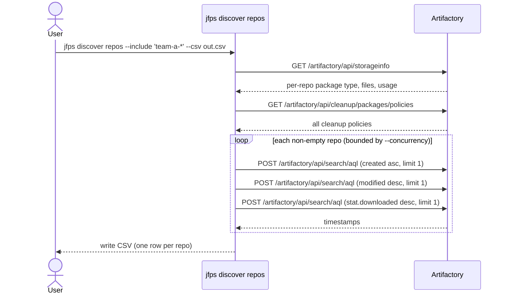
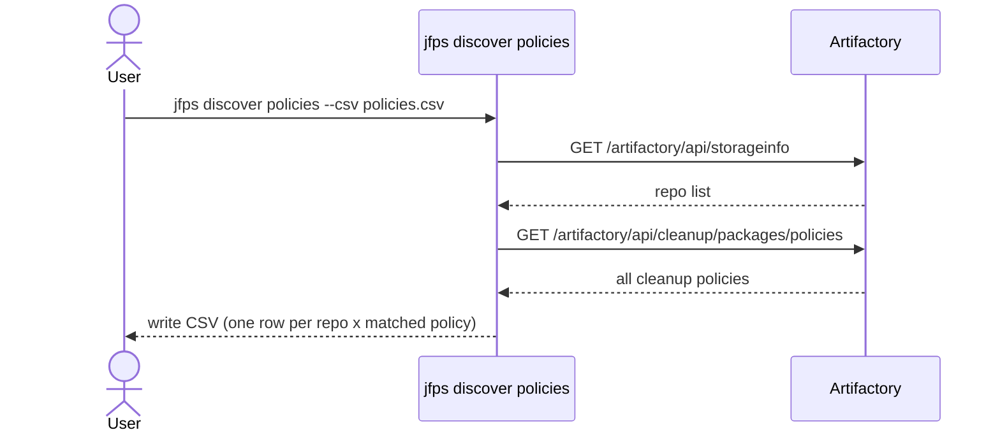
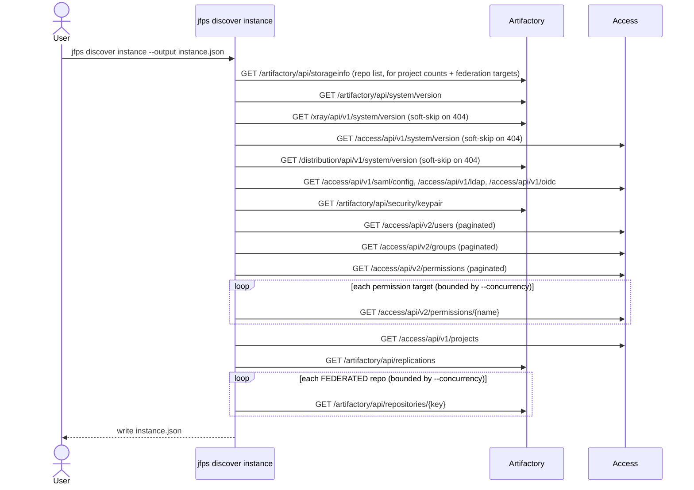
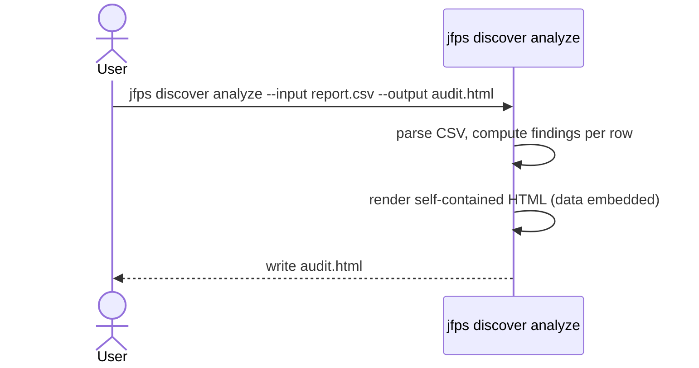

# `jfps discover`

Repo storage/activity/cleanup-policy reporting, instance-wide discovery
(versions, storage, auth/signing keys, users/groups/permissions, projects,
replication & federation config), and turning all of that into a
self-contained interactive HTML audit. All four subcommands are read-only —
none of them ever issues a write call to Artifactory; `analyze` makes no
network calls at all.

Artifactory tracks neither a repo's own creation time nor a "last activity"
field, and has no reverse "which cleanup policy applies to this repo" or
"which policy applies to this project" lookup — `repos`/`policies`/`instance`
derive these via AQL and client-side matching.

| Subcommand | What it does |
|---|---|
| [`repos`](#repos) | Per-repo package type, file count, usage, project assignment, created/last-push/last-pull, and matched cleanup-policy detail → CSV |
| [`policies`](#policies) | Map every repo to its matching cleanup policy/policies (one row per repo × match) → CSV |
| [`instance`](#instance) | Component versions, storage summary, auth/signing-key config, users, groups, permission-target access, projects, replication & federation config → JSON |
| [`analyze`](#analyze) | Turn a `repos` CSV (optionally + an `instance` JSON) into a self-contained interactive HTML audit — no JPD connection |

---

## `repos`

**What it does:** Fetches every repo's package type, file count, and usage
from `/api/storageinfo`, then (for non-empty repos, concurrently) derives:

- `created_date` — proxy: creation time of the repo's oldest item
- `last_push_date` — proxy: modification time of the repo's newest item
- `last_pull_date` — most recent `stat.downloaded` across the repo's items
- `last_activity_date` — the later of the two above

and, by default, every matched cleanup policy's key, enabled state, cron
expression, and full retention criteria (days *and* months variants, plus
keep-last-N-versions) — `|`-joined when a repo matches more than one policy.

**Key flags:**
- `--concurrency` (default `8`) — repos processed in parallel; keep modest on shared instances
- `--cleanup-policies` (default `true`) — include the policy-detail columns (one extra API call)
- `--include` / `--exclude` — comma-separated glob patterns to scope a run
- `--csv` — write to a file instead of stdout

**Safety notes:** none (read-only). On a large/shared instance, scope with
`--include`/`--exclude` first — each non-empty repo costs 3 AQL calls.

---

## `policies`

**What it does:** The same repo ↔ policy matching as `repos`, but as one row
per repo × matched policy (or a blank-policy row when nothing matches) —
useful for spotting ambiguous or overlapping cleanup-policy coverage that a
single joined column would hide.

**Key flags:** `--csv` — write to a file instead of stdout

**Safety notes:** none (read-only, no AQL calls — just the two list endpoints)

---

## `instance`

**What it does:** Collects instance-wide state that isn't per-repo:

- **Component versions** — Artifactory (required), Xray/Access/Distribution
  (soft-skipped as "not available" on a 404, e.g. unlicensed or not installed)
- **Storage summary** — from `/api/storageinfo`'s `binariesSummary`/`fileStoreSummary`
- **Authentication** — whether SAML and/or LDAP are configured, and every
  configured OIDC identity provider
- **Repository signing keys** — pair name/type/alias only, **never key
  material** (public or private) — flagged prominently in `analyze`'s output
  when any exist
- **Users** and **groups** (paginated via the Access API's cursor)
- **Permission targets** — repo scope plus user/group grants, fetched
  concurrently per target
- **Projects** — with each one's repo count cross-referenced from the repo list
- **Replication configs** — one bulk call, no per-repo lookup needed
- **Federated repos' member config** — fetched per federated repo (no bulk
  endpoint exists for this), concurrently

Only the Artifactory version fetch is fatal; everything else soft-fails into
the output's `warnings` array so one broken/unlicensed endpoint doesn't blank
out the rest of the snapshot.

**Key flags:**
- `--concurrency` (default `8`) — permission-target detail and federated-repo config fetches
- `--max-users` / `--max-groups` / `--max-permissions` (defaults `5000`/`5000`/`2000`) — caps with an explicit truncation warning if hit, never a silent one
- `--output` (default `instance.json`)

**Safety notes:** none (read-only).

---

## `analyze`

**What it does:** Reads a CSV produced by `discover repos` (from this
environment or any other — it never talks to Artifactory), optionally plus a
JSON snapshot from `discover instance`, and writes one self-contained HTML
file. All data is embedded in the HTML.

With just `--input`, the report is a single "Repos" view: summary stats,
clickable findings, and a searchable/filterable repo explorer with a per-repo
detail drawer.

Adding `--instance` adds four more tabs:
- **Overview** — component versions, storage summary, authentication methods,
  and a highlighted callout for repository signing keys if any are configured
- **Access** — searchable Users, Groups, and Permission Targets tables (the
  last showing repo scope plus user/group grants)
- **Projects** — searchable table with each project's repo count (cross-reference
  against the Repos tab's `project_key` column to see exactly which repos —
  including ones with no project, `project_key` `"default"` — belong where)
- **Federation & Replication** — federated repos' member config, and every
  configured replication

Findings: `empty` (zero files), `stale` (no push/pull inside `--stale-days`,
or none recorded despite having files), `huge` / `massive-files` (over
`--huge-gb` / `--massive-files`), `naming-nonconformant` / `uppercase` /
`underscore` / `very-long-name` (lowercase-hyphen key hygiene),
`no-cleanup-policy` (no policy's scope matches), `multi-policy-match` (more
than one policy's scope overlaps — worth confirming that's intentional). A
finding whose source column is missing from the input CSV (e.g. after
`discover repos --cleanup-policies=false`) is skipped rather than
mis-flagged.

**Key flags:**
- `--input` (required) — path to a `discover repos` CSV
- `--instance` (optional) — path to a `discover instance` JSON snapshot
- `--output` (default `repo-audit.html`)
- `--stale-days` (default `180`), `--huge-gb` (default `500`),
  `--massive-files` (default `500000`), `--long-name-chars` (default `40`)

**Safety notes:** none — this subcommand makes no network calls at all.

