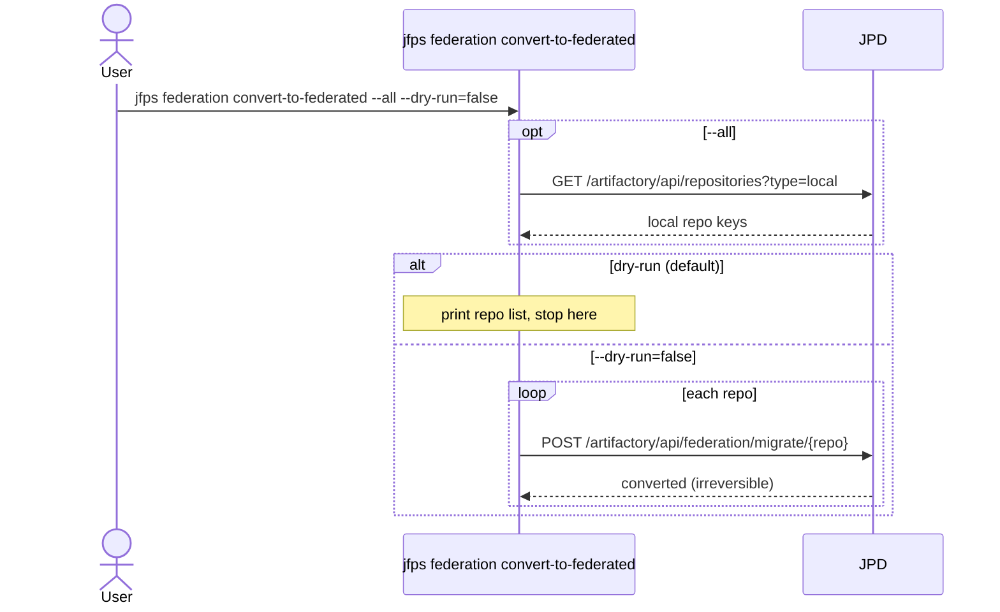
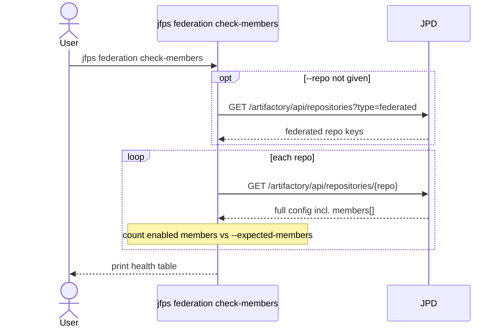
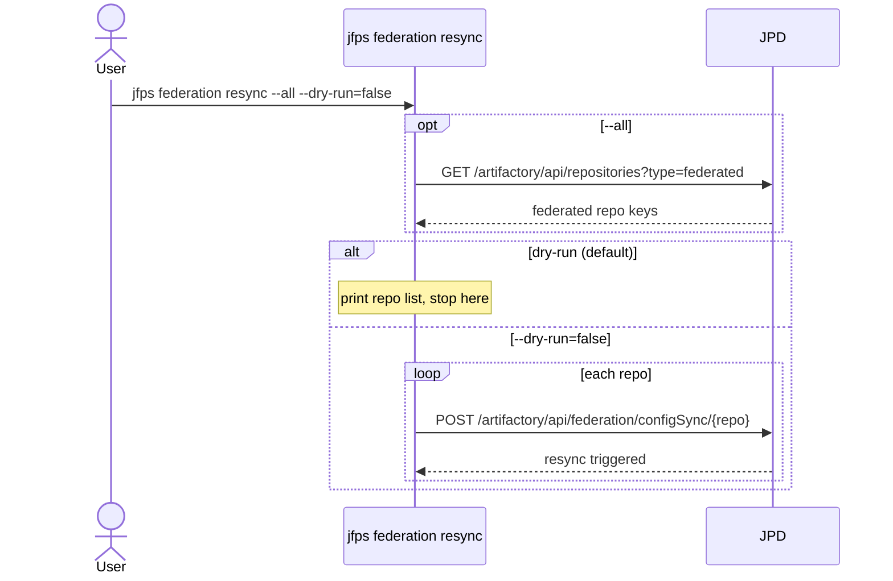
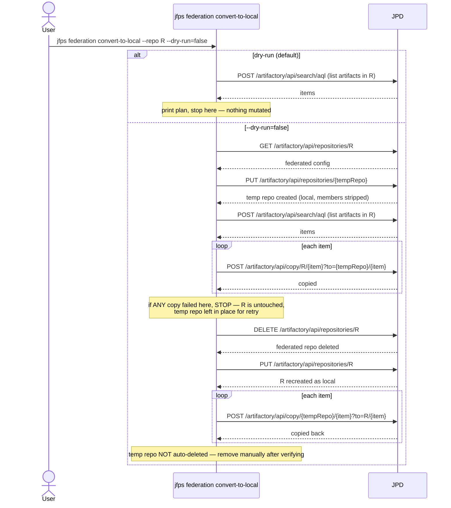

# `jfps federation`

Manages Artifactory federated repositories against a single JPD (no
source/target pair): converting local repos to federated (irreversible),
converting federated repos back to local (via a safe temp-repo copy dance),
auditing federation member health, and triggering config-only resyncs.

**Safety model:** mutating subcommands default `--dry-run=true`; none of
them use an interactive `--yes` confirmation prompt — dry-run is the only
gate. `convert-to-local` is the exception worth reading closely: it has no
confirmation prompt either, but the implementation itself is fail-safe (see
below).

| Subcommand | What it does |
|---|---|
| [`convert-to-federated`](#convert-to-federated) | Migrate one or all local repos to federated (irreversible) |
| [`check-members`](#check-members) | Report federation member health |
| [`resync`](#resync) | Trigger a federation config (not data) resync |
| [`convert-to-local`](#convert-to-local) | Convert a federated repo back to local, preserving content |

---

## `convert-to-federated`

**What it does:** Migrates one or all local repos to federated repos. This is an **irreversible** platform-level conversion.

**Key flags:** `--repo`/`--all` (mutually exclusive), `--dry-run` (default `true`)

**Safety notes:** defaults to dry-run; no interactive confirmation exists even with `--dry-run=false`, despite the operation being irreversible — treat `--dry-run=false` here with the same care as a destructive delete.

---

## `check-members`

**What it does:** Reports federation member health (member count, disabled members) for one or all federated repos. Read-only.

**Key flags:** `--repo` (default: all federated repos), `--expected-members` (default `2`)

**Safety notes:** none (read-only)

---

## `resync`

**What it does:** Triggers a federation **config** resync (member list/ACLs) for one or all federated repos — this does not resync artifact data.

**Key flags:** `--repo`/`--all` (mutually exclusive), `--dry-run` (default `true`)

**Safety notes:** defaults to dry-run; no interactive confirmation gate (lower risk than `convert-to-federated`, since this only resyncs config, not data).

---

## `convert-to-local`

**What it does:** Converts a federated repo back to local while preserving its content, by copying everything through a temporary repo, deleting the federated repo, recreating it as local, and copying the content back in. Fail-safe by construction: if the forward copy (into the temp repo) has any failure, the federated repo is **never deleted** — the temp repo is left in place and the user is told to fix and retry. The temp repo is never auto-deleted even on full success; the user must remove it manually after verifying.

**Key flags:** `--repo` (required), `--temp-repo` (default `<repo>-temp`), `--dry-run` (default `true`, read-only plan)

**Safety notes:** dry-run is read-only (just prints the migration plan via an AQL listing); `--dry-run=false` has no interactive confirmation, but the multi-step implementation aborts before the point of no return (deleting the source repo) if anything upstream of it fails.

