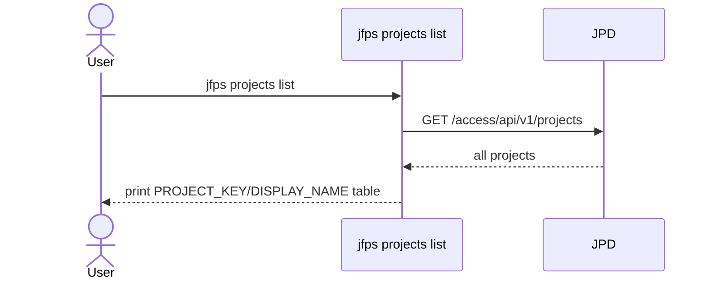
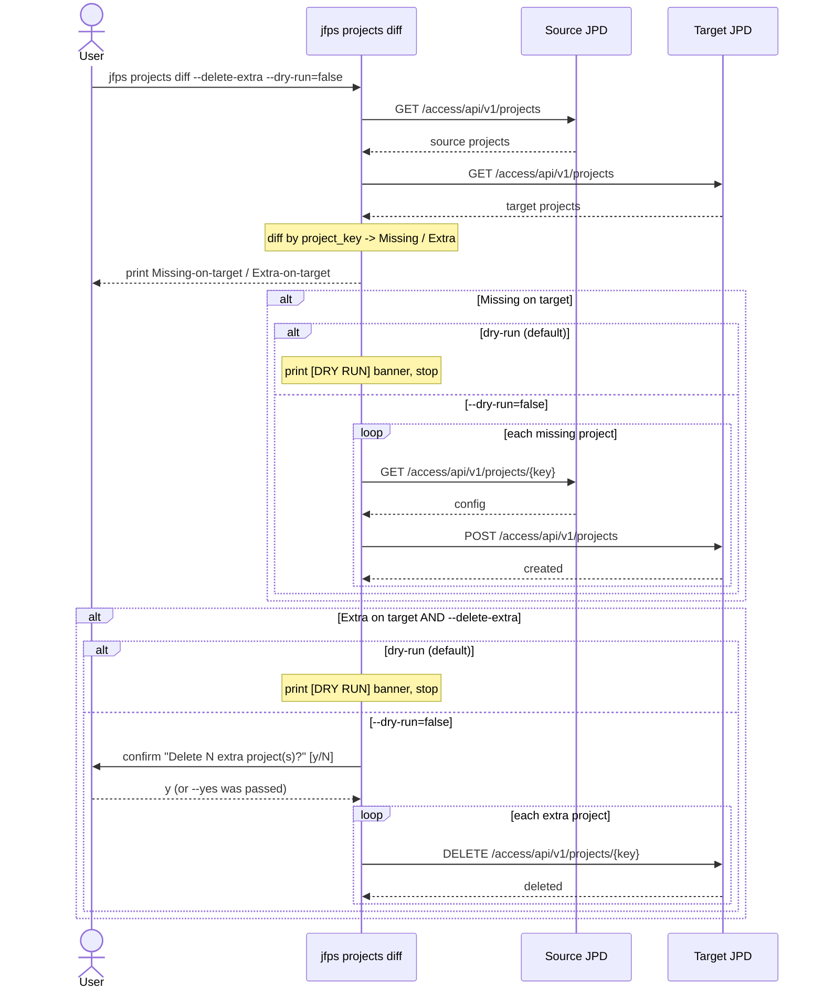
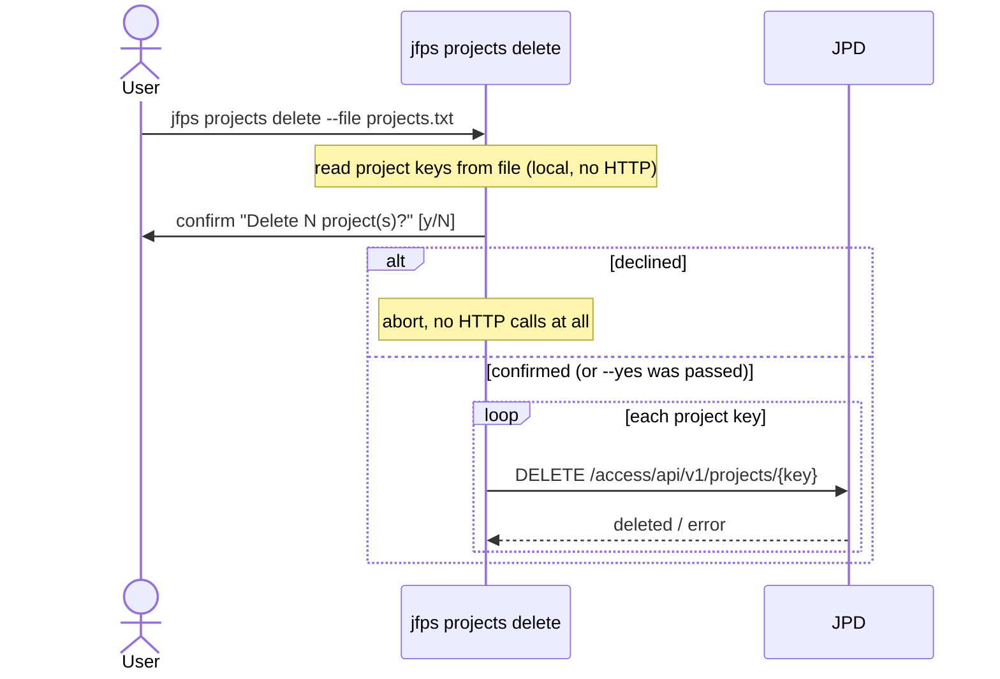

# `jfps projects`

Manages JFrog Projects (Access API v1): listing them on one server, diffing
two servers' project sets to create-missing/optionally-delete-extra on a
target, and bulk-deleting projects by key from a file.

| Subcommand | What it does |
|---|---|
| [`list`](#list) | List all projects on one server |
| [`diff`](#diff) | Create projects missing on target; optionally delete extras on target |
| [`delete`](#delete) | Bulk-delete projects listed in a file |

---

## `list`

**What it does:** Lists all JFrog Projects on a single server.

**Safety notes:** none (read-only)

---

## `diff`

**What it does:** Compares projects between a source and target server. Creates projects missing on target (unless dry-run). If `--delete-extra` is also given, additionally deletes target-only projects.

**Key flags:** `--dry-run` (default `true`), `--delete-extra`, `--yes`

**Safety notes:** `--dry-run` gates both creates and deletes; deleting extras additionally requires `--delete-extra` plus (`--yes` or interactive confirmation).

---

## `delete`

**What it does:** Bulk-deletes projects whose keys are listed, one per line, in a file.

**Key flags:** `--file` (required), `--yes`

**Safety notes:** there is no `--dry-run` flag on this subcommand by design (mirrors the original script's "confirm once, then do it") — an interactive confirmation (or `--yes`) is mandatory before any DELETE is issued, so nothing is deleted without at least one explicit gate.

