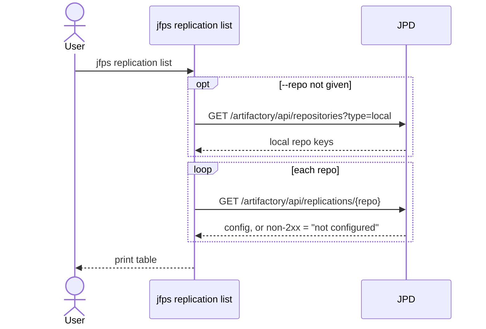
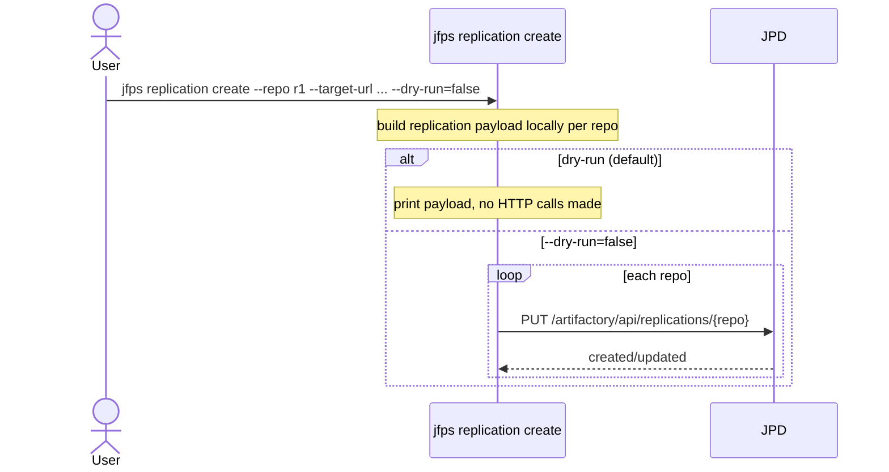
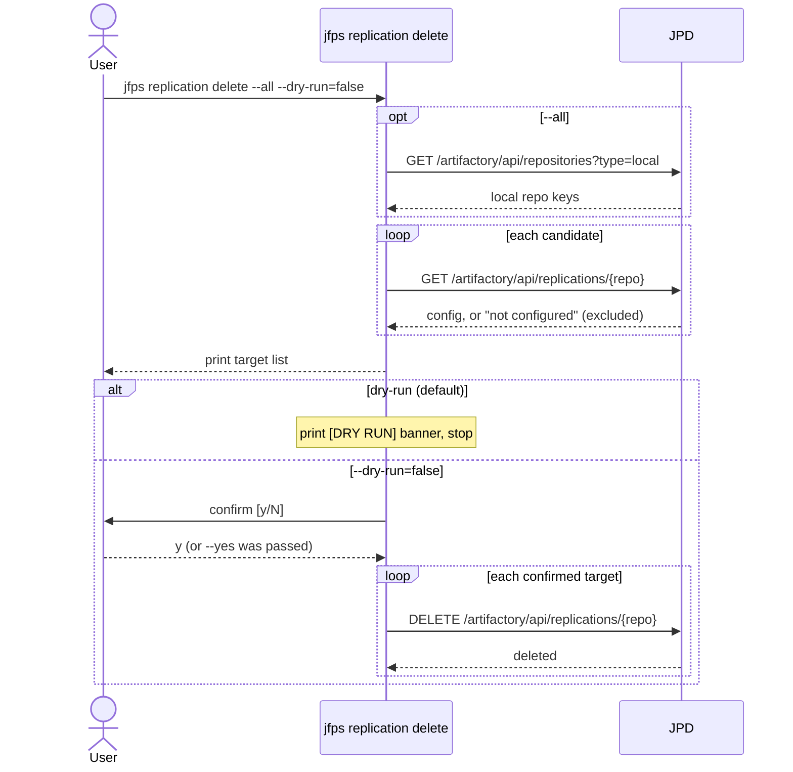
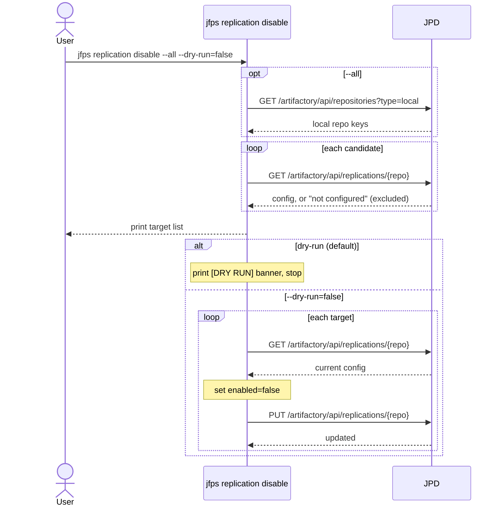
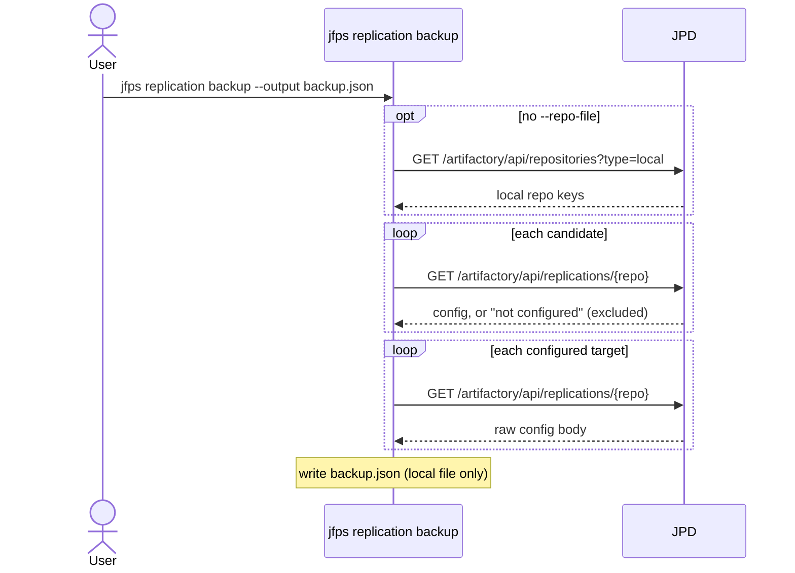
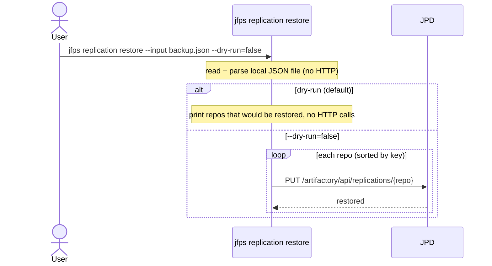

# `jfps replication`

Manages Artifactory push replication configuration end-to-end against a
single JPD (there's no cross-server source/target pair for most
subcommands — `create` just writes a target URL into the payload it sends
to that one server). Covers discovery (`list`), setup (`create`), teardown
(`delete`, `disable`), and config portability (`backup`/`restore` to/from a
local JSON file).

| Subcommand | What it does |
|---|---|
| [`list`](#list) | Show whether push replication is configured, and its target(s) |
| [`create`](#create) | Create push replication from one or more repos to a target JPD/repo |
| [`delete`](#delete) | Remove push replication config from one repo or all configured repos |
| [`disable`](#disable) | Turn off (not delete) push replication |
| [`backup`](#backup) | Save replication config to a local JSON file |
| [`restore`](#restore) | Re-apply a replication config previously saved by `backup` |

---

## `list`

**What it does:** Shows whether push replication is configured for one repo or all local repos, and its target URL(s). A non-2xx response for a repo is treated as "not configured," not an error.

**Key flags:** `--repo` (default: all local repos)

**Safety notes:** none (read-only)

---

## `create`

**What it does:** Creates push replication from one or more source repos to a target JPD/repo, on a cron schedule.

**Key flags:** `--repo`/`--repo-file` (one required), `--target-*` connection flags (embedded in the payload), `--target-repo` (default: same key), `--cron` (default `0 0/6 * * * ?`), `--sync-deletes` (default `false`), `--enabled` (default `true`), `--dry-run` (default `true`)

**Safety notes:** dry-run defaults to true and skips all PUT calls; there is no interactive confirmation even with `--dry-run=false`.

---

## `delete`

**What it does:** Removes push replication configuration from one repo or every configured local repo.

**Key flags:** `--repo`/`--all` (one required), `--dry-run` (default `true`), `--yes`

**Safety notes:** dry-run defaults to true; when disabled, an interactive confirmation is required unless `--yes` is passed.

---

## `disable`

**What it does:** Turns off (but does not delete) push replication for one repo or every configured local repo, by rewriting `enabled: false` into the existing config.

**Key flags:** `--repo`/`--all` (one required), `--dry-run` (default `true`)

**Safety notes:** dry-run defaults to true; unlike `delete`, there is **no `--yes`/confirmation gate** — disabling is treated as lower-risk/reversible.

---

## `backup`

**What it does:** Saves the raw replication config of one or more repos to a local JSON file for later `restore`. Read-only against the server — only a local file is written.

**Key flags:** `--output` (required), `--repo-file` (default: all local repos)

**Safety notes:** none (read-only against the server)

---

## `restore`

**What it does:** Re-applies replication configs previously saved by `backup`.

**Key flags:** `--input` (required), `--dry-run` (default `true`)

**Safety notes:** dry-run defaults to true; no interactive confirmation gate when disabled.

