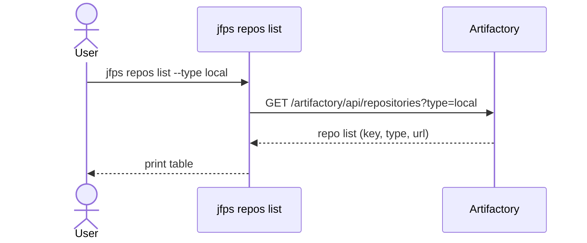
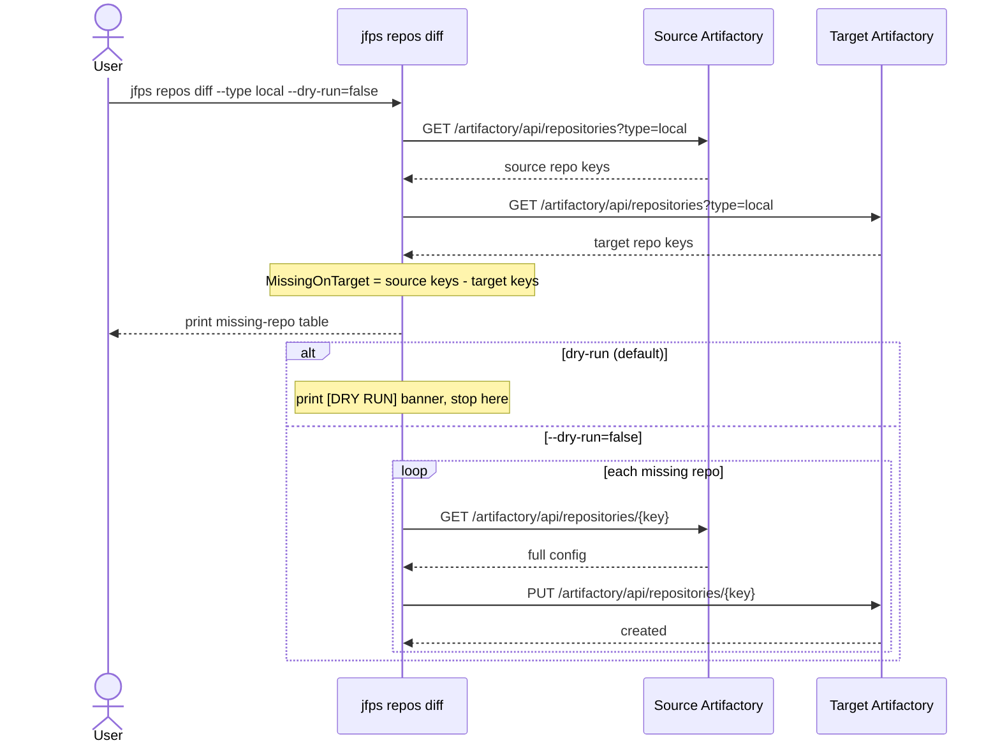
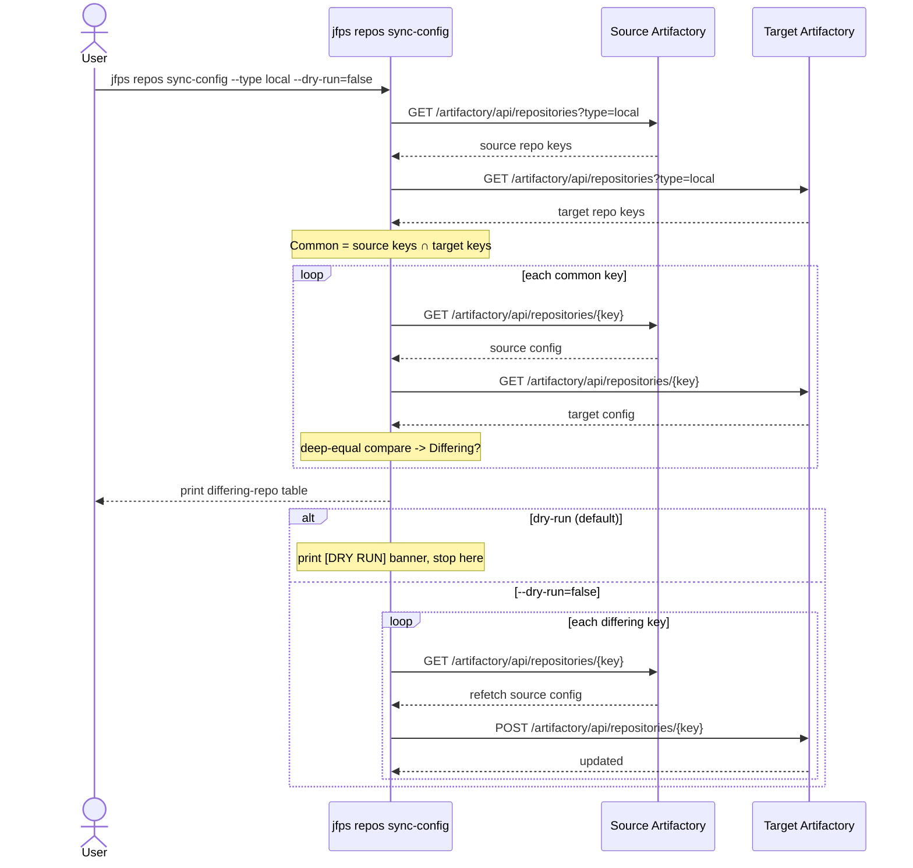
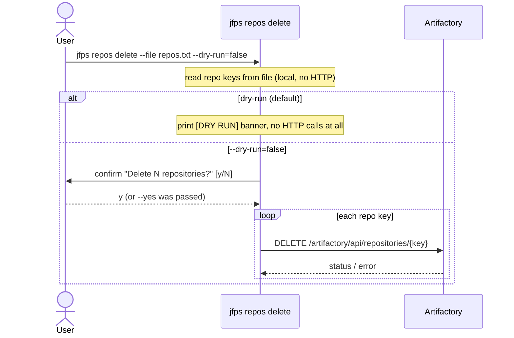
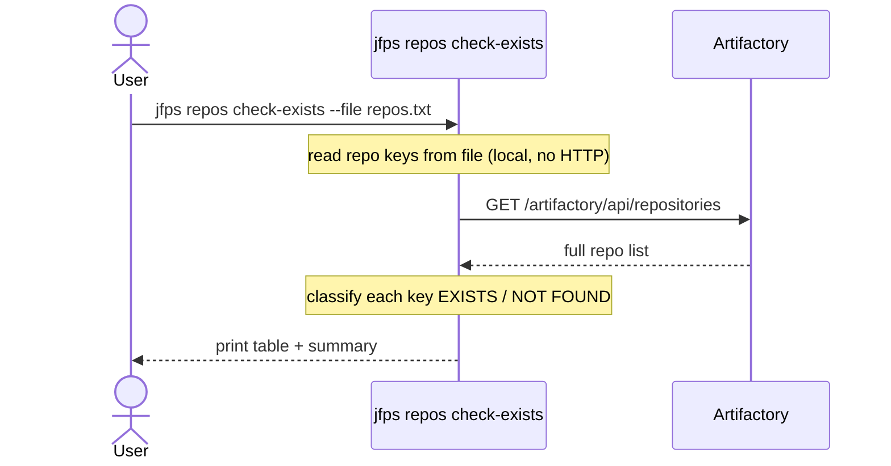
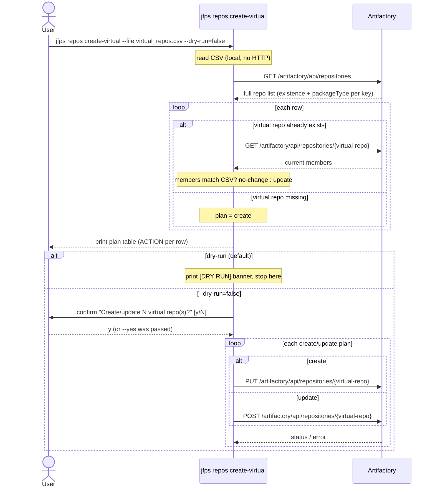

# `jfps repos`

Manages Artifactory repository lifecycle: listing repos on one server,
diffing/creating missing repos between a source and target server (never
deletes), syncing full repo configuration to bring an existing target repo
in line with source, bulk-deleting repos from a file, checking whether a
list of repos exists, and creating/updating two-member virtual repos from a
CSV file. `diff` and `sync-config` always operate two-server
(`--source-*`/`--target-*`); `list`/`delete`/`check-exists`/`create-virtual`
are single-server.

| Subcommand | What it does |
|---|---|
| [`list`](#list) | List repositories on one server, optionally filtered by type |
| [`diff`](#diff) | Find repos missing on target vs. source, optionally create them |
| [`sync-config`](#sync-config) | Push source config to target for repos present on both, where they differ |
| [`delete`](#delete) | Bulk-delete repositories listed in a file |
| [`check-exists`](#check-exists) | Check whether repositories listed in a file exist on a server |
| [`create-virtual`](#create-virtual) | Create/update two-member (local+remote) virtual repos from a CSV file |

---

## `list`

**What it does:** Lists repositories on a single server, optionally filtered by type.

**Key flags:** `--type` (default `all`) — local, remote, virtual, federated, or all

**Safety notes:** none (read-only)

---

## `diff`

**What it does:** Finds repos present on source but missing on target, and — unless in dry-run — creates them on target by copying source's full config. Never deletes anything, and never touches repos that already exist on target.

**Key flags:** `--type` (required), `--dry-run` (default `true`), uses `--source-*`/`--target-*` server flags

**Safety notes:** dry-run defaults to true and is checked before any create call; there is no interactive confirmation even with `--dry-run=false`.

---

## `sync-config`

**What it does:** For repos present on **both** servers, compares full configuration and pushes source's config to target wherever it differs. Only ever updates existing target repos — never creates or deletes.

**Key flags:** `--type` (required), `--dry-run` (default `true`), uses `--source-*`/`--target-*` server flags

**Safety notes:** dry-run defaults to true and gates the update calls; there is no interactive confirmation when disabled.

---

## `delete`

**What it does:** Bulk-deletes repositories whose keys are listed, one per line, in a file (blank lines and `#`-comments skipped).

**Key flags:** `--file` (required), `--dry-run` (default `true`), `--yes`

**Safety notes:** dry-run skips *all* HTTP calls, not just the deletes. When disabled, an interactive `y/N` confirmation is also required unless `--yes` is passed.

---

## `check-exists`

**What it does:** Checks whether repository keys listed, one per line, in a file exist on a single server. Reports EXISTS/NOT FOUND per key.

**Key flags:** `--file` (required), `--type` (default `all`) — local, remote, virtual, federated, or all

**Safety notes:** none (read-only). Exit code is `1` if any key is not found, so it's usable as a CI gate.

---

## `create-virtual`

**What it does:** Creates or updates two-member virtual repositories (one local + one remote repo each) from a CSV file. For each row, validates that both member repos exist and share the same package type, then creates the virtual repo if it doesn't exist, updates it if its current members differ from the CSV, or reports "no-change" if they already match. Never touches the member repos themselves.

**Key flags:** `--file` (required CSV with `new-virtual-repo`, `local-name`, `remote-name` columns), `--dry-run` (default `true`), `--yes`

**Safety notes:** validation (member existence, package-type match, and — for already-existing virtual repos — a config fetch to detect whether an update is actually needed) always runs, even in dry-run; only the final create/update call is gated by `--dry-run` and, when disabled, an interactive confirmation (unless `--yes`).

