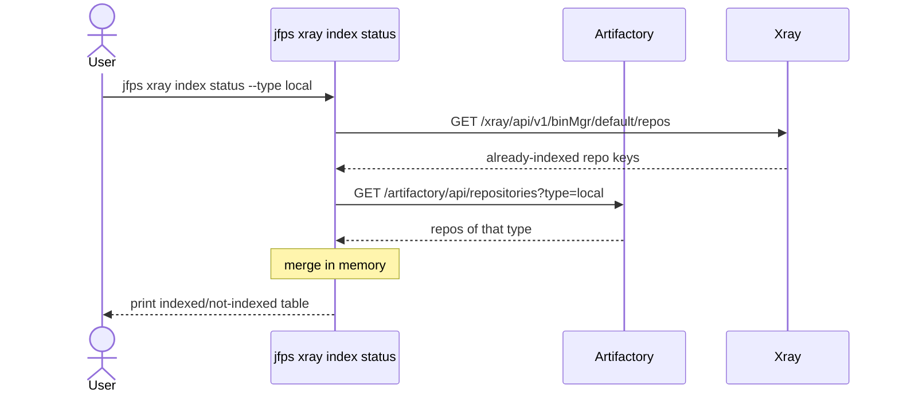
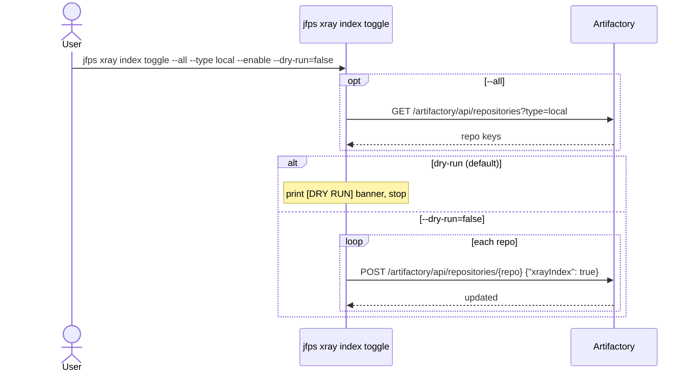
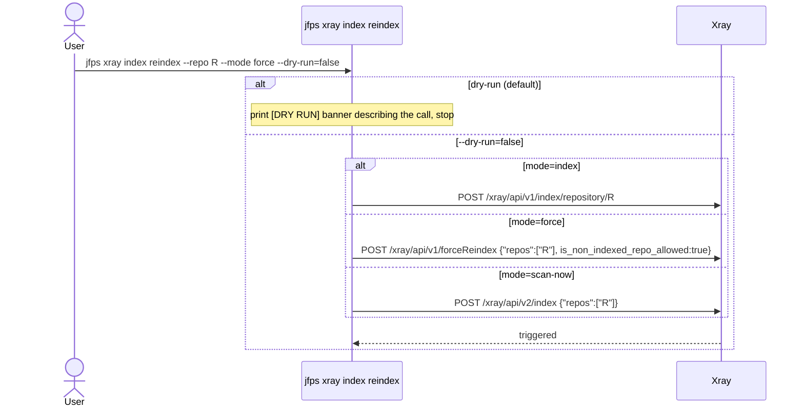
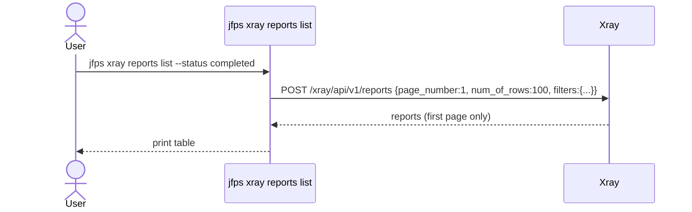
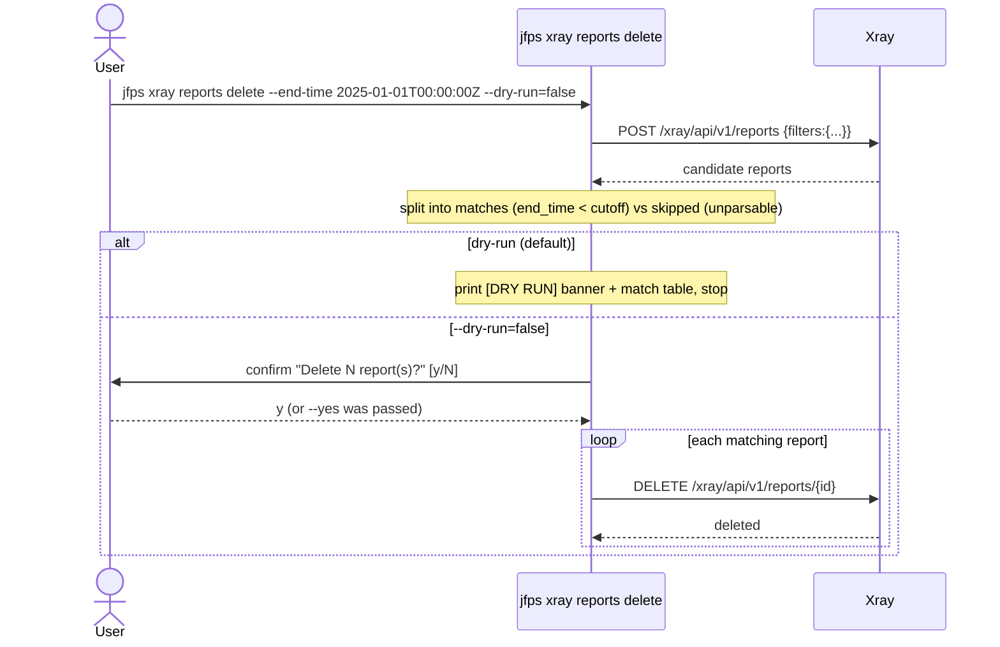
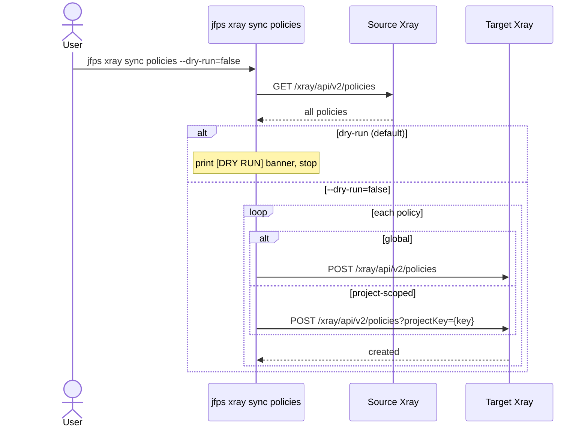
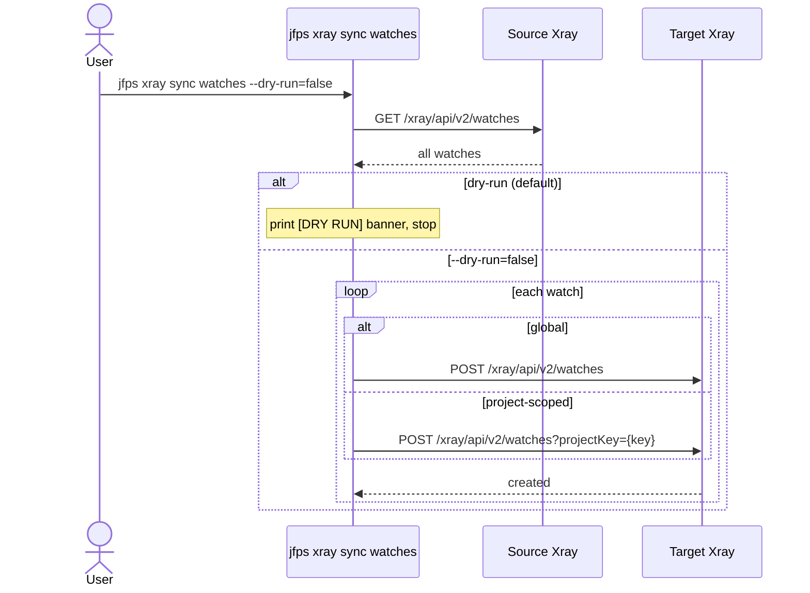

# `jfps xray`

Manages three areas of Xray operation: repository indexing (check which
repos are Xray-indexed, toggle indexing on/off, trigger re-index/rescan),
scan-report lifecycle (list/filter reports, bulk-delete old ones by
end-time cutoff), and cross-JPD synchronization of security policies,
watches, and ignore rules. Indexing and reports operate against a single
server; `sync` operates against a source/target pair.

**Safety model:** all mutating actions default `--dry-run=true`. `reports
delete` additionally requires interactive confirmation unless `--yes` is
passed; the other mutating actions (`index toggle`, `index reindex`, `sync
*`) have no confirmation gate beyond dry-run.

| Subcommand | What it does |
|---|---|
| [`index status`](#index-status) | Show which repos of a type are Xray-indexed |
| [`index toggle`](#index-toggle) | Enable/disable Xray indexing on one repo or a type |
| [`index reindex`](#index-reindex) | Trigger (re)indexing/rescanning of a repo |
| [`reports list`](#reports-list) | List Xray reports, optionally filtered |
| [`reports delete`](#reports-delete) | Bulk-delete reports older than a cutoff |
| [`sync policies`](#sync-policies) | Copy every security policy from source to target |
| [`sync watches`](#sync-watches) | Copy every watch from source to target |
| [`sync ignore-rules`](#sync-ignore-rules) | Copy every ignore rule from source to target |

---

## `index status`

**What it does:** Shows which repositories of a given type are Xray-indexed.

**Key flags:** `--type` (default `local`)

**Safety notes:** none (read-only)

---

## `index toggle`

**What it does:** Enables or disables Xray indexing on one repo or every repo of a type.

**Key flags:** `--repo`/`--all` (mutually exclusive; `--type` required with `--all`), `--enable`/`--disable`, `--dry-run` (default `true`)

**Safety notes:** dry-run default; no interactive confirmation gate even at `--dry-run=false`.

---

## `index reindex`

**What it does:** Triggers (re)indexing or rescanning of a single repo, in one of three modes: `index` (standard, adds a newly-indexed repo), `force` (full re-scan, needs Xray Admin, can be expensive), or `scan-now` (also needs Xray Admin, also expensive on large repos).

**Key flags:** `--repo` (required), `--mode` = `index`\|`force`\|`scan-now` (required), `--dry-run` (default `true`)

**Safety notes:** dry-run default; no `--yes`/confirmation prompt — be deliberate with `force`/`scan-now` on large repos.

---

## `reports list`

**What it does:** Lists Xray reports, optionally filtered by status/type. Fetches a single page (100 rows) — no pagination loop yet.

**Key flags:** `--status`, `--report-type`

**Safety notes:** none (read-only)

---

## `reports delete`

**What it does:** Bulk-deletes reports whose `end_time` is before a given RFC3339 cutoff (`--status`/`--report-type` further narrow the candidate list; reports with an unparsable `end_time` are skipped, not deleted).

**Key flags:** `--status`, `--report-type`, `--end-time` (required, RFC3339), `--dry-run` (default `true`), `--yes`

**Safety notes:** dry-run default; additionally gated by interactive confirmation unless `--yes` is passed.

---

## `sync policies`

**What it does:** Copies every Xray security policy from a source JPD to a target JPD. Project-scoped policies are posted with `?projectKey=<key>` and have `project_key` stripped from the body; global policies are posted plainly.

**Key flags:** `--dry-run` (default `true`), uses `--source-*`/`--target-*` connection flags

**Safety notes:** dry-run default; no interactive confirmation/`--yes` gate.

---

## `sync watches`

**What it does:** Copies every Xray watch from source to target, same project-scoping rules as `sync policies` (nested `general_data.project_key` is stripped for project-scoped watches).

**Key flags:** `--dry-run` (default `true`), uses `--source-*`/`--target-*` connection flags

**Safety notes:** dry-run default; no confirmation/`--yes` gate.

---

## `sync ignore-rules`

**What it does:** Copies every Xray ignore rule from source to target, same project-scoping pattern. The project-key handling for this specific endpoint is a documented, unverified assumption (mirrors `sync policies`'s shape rather than a confirmed schema).

**Key flags:** `--dry-run` (default `true`), uses `--source-*`/`--target-*` connection flags

**Safety notes:** dry-run default; no confirmation/`--yes` gate.

