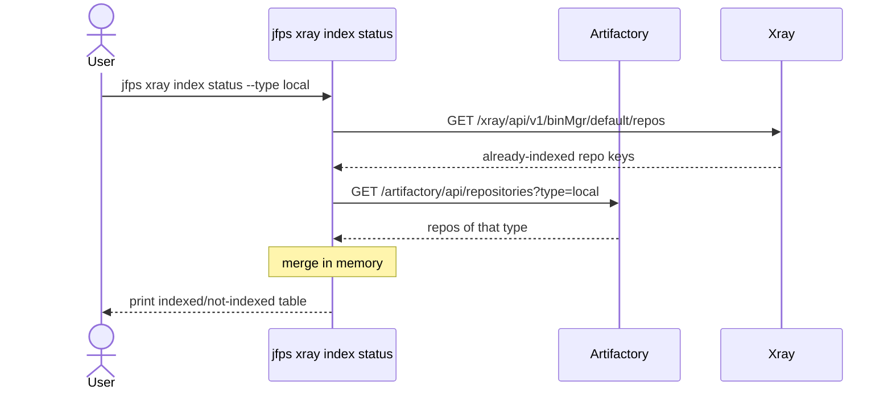
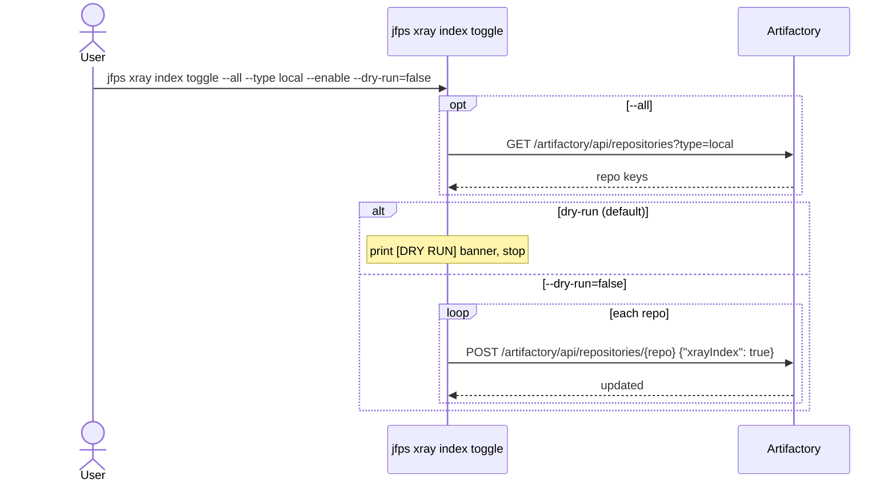
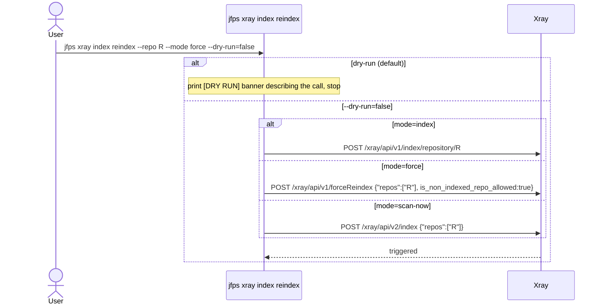
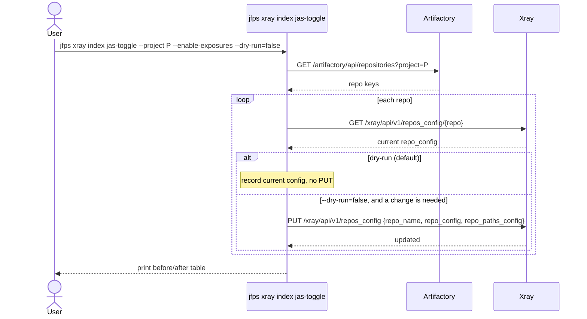
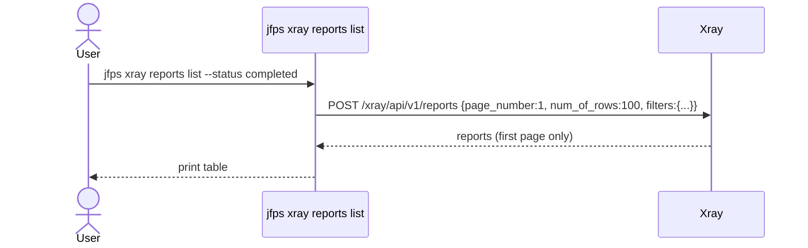
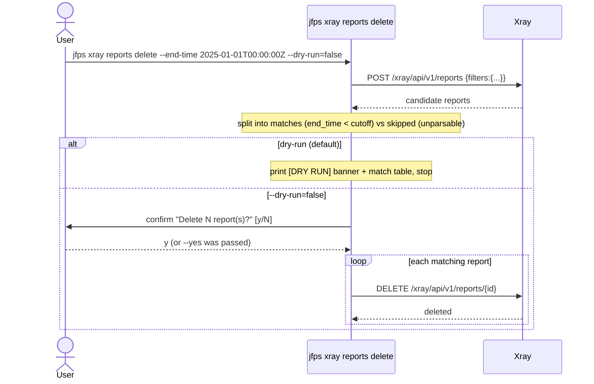
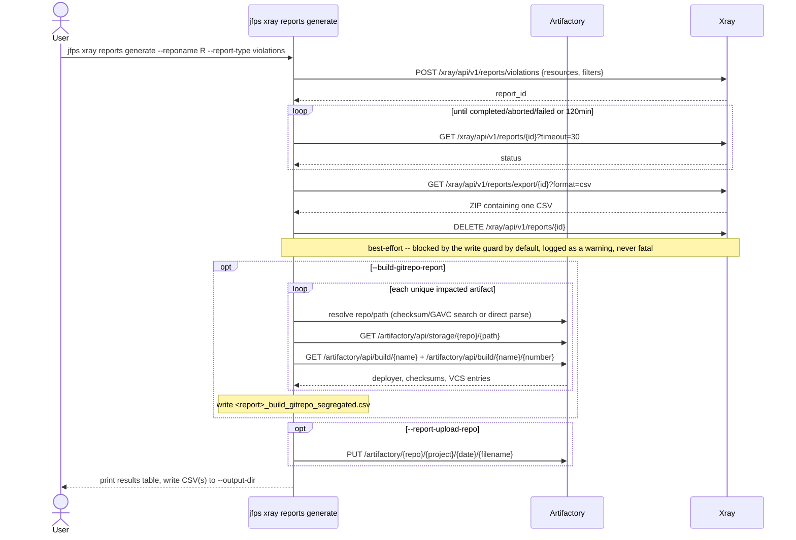
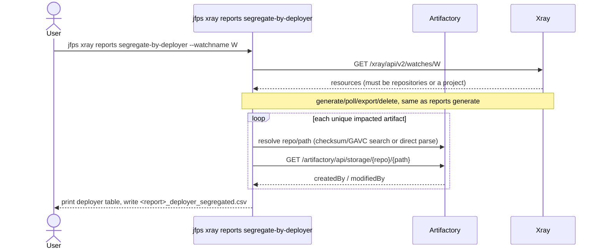
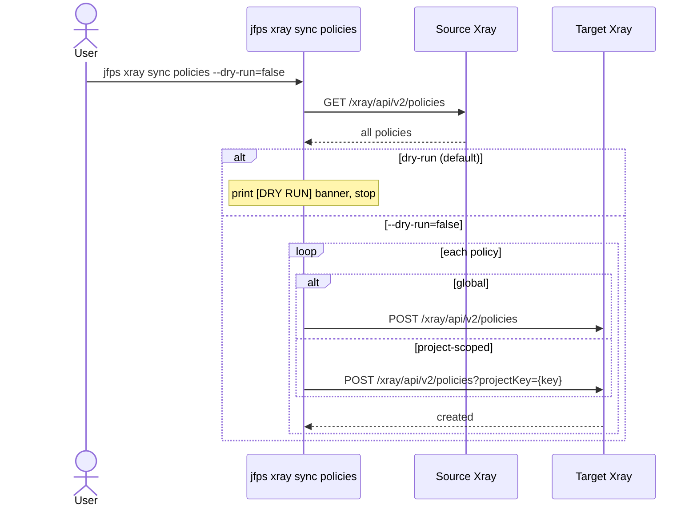
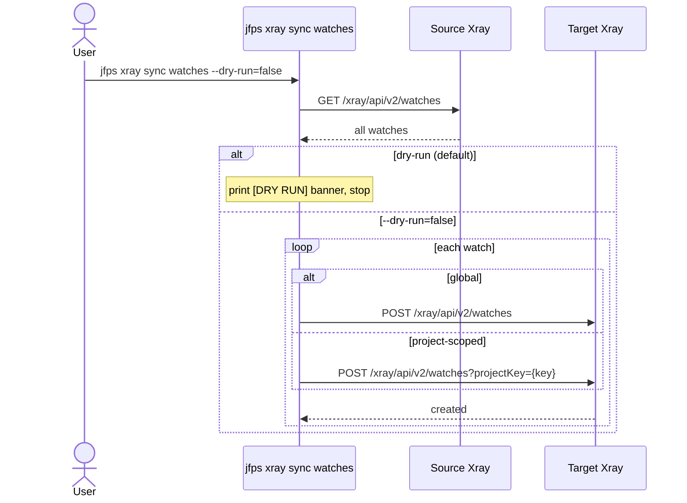

# `jfps xray`

Manages three areas of Xray operation: repository indexing (check which
repos are Xray-indexed, toggle indexing on/off, trigger re-index/rescan,
toggle JAS/Contextual-Analysis scanners), scan-report lifecycle
(list/filter/delete reports, generate new Violations/Vulnerabilities/
Exposures reports and segregate their findings by deployer or by producing
build), and cross-JPD synchronization of security policies, watches, and
ignore rules. Indexing and reports operate against a single server; `sync`
operates against a source/target pair.

**Safety model:** all mutating actions default `--dry-run=true`. `reports
delete` additionally requires interactive confirmation unless `--yes` is
passed; the other mutating actions (`index toggle`, `index reindex`, `index
jas-toggle`, `sync *`) have no confirmation gate beyond dry-run. `reports
generate`/`segregate-by-deployer` are not "mutating" in that sense (they
don't touch repo/user/permission config) but they do create a transient
Xray report server-side for the duration of the run, cleaned up automatically
afterward -- see [`reports generate`](#reports-generate) for what happens to
that cleanup step while the CLI's write guard is on.

| Subcommand | What it does |
|---|---|
| [`index status`](#index-status) | Show which repos of a type are Xray-indexed |
| [`index toggle`](#index-toggle) | Enable/disable Xray indexing on one repo or a type |
| [`index reindex`](#index-reindex) | Trigger (re)indexing/rescanning of a repo |
| [`index jas-toggle`](#index-jas-toggle) | Enable/disable JAS Exposures scanners / Contextual Analysis on repos |
| [`reports list`](#reports-list) | List Xray reports, optionally filtered |
| [`reports delete`](#reports-delete) | Bulk-delete reports older than a cutoff |
| [`reports generate`](#reports-generate) | Generate a Violations/Vulnerabilities/Exposures report, optionally segregated by producing build's Git repo |
| [`reports segregate-by-deployer`](#reports-segregate-by-deployer) | Generate a watch-scoped report and segregate findings by the deploying user |
| [`sync policies`](#sync-policies) | Copy every security policy from source to target |
| [`sync watches`](#sync-watches) | Copy every watch from source to target |
| [`sync ignore-rules`](#sync-ignore-rules) | Copy every ignore rule from source to target |

---

## `index status`

**What it does:** Shows which repositories of a given type are Xray-indexed.

**Key flags:** `--type` (default `local`)

**Safety notes:** none (read-only)

---

## `index toggle`

**What it does:** Enables or disables Xray indexing on one repo or every repo of a type.

**Key flags:** `--repo`/`--all` (mutually exclusive; `--type` required with `--all`), `--enable`/`--disable`, `--dry-run` (default `true`)

**Safety notes:** dry-run default; no interactive confirmation gate even at `--dry-run=false`.

---

## `index reindex`

**What it does:** Triggers (re)indexing or rescanning of a single repo, in one of three modes: `index` (standard, adds a newly-indexed repo), `force` (full re-scan, needs Xray Admin, can be expensive), or `scan-now` (also needs Xray Admin, also expensive on large repos).

**Key flags:** `--repo` (required), `--mode` = `index`\|`force`\|`scan-now` (required), `--dry-run` (default `true`)

**Safety notes:** dry-run default; no `--yes`/confirmation prompt — be deliberate with `force`/`scan-now` on large repos.

---

## `index jas-toggle`

**What it does:** Enables/disables JAS Exposures scanner categories
(secrets/services/applications/iac) and/or Contextual Analysis, and/or sets
scan-result retention, on one repo, every repo in a project, or a
newline-delimited file of repo keys. Only fields already present in a
repo's current config are touched (mirroring the source script's defensive
behavior across repo types/Xray versions); `--enable-exposures` sets every
*present* scanner category to `true` uniformly (there's no per-category
flag). In dry-run (default), only the current configuration is fetched and
printed -- no PUT is attempted at all.

**Key flags:** `--repo`/`--project`/`--repos-file` (mutually exclusive),
`--enable-exposures`/`--disable-exposures`, `--enable-contextual-analysis`/
`--disable-contextual-analysis`, `--retention-days`, `--dry-run` (default
`true`)

**Safety notes:** dry-run default; no interactive confirmation gate even at
`--dry-run=false`.

---

## `reports list`

**What it does:** Lists Xray reports, optionally filtered by status/type. Fetches a single page (100 rows) — no pagination loop yet.

**Key flags:** `--status`, `--report-type`

**Safety notes:** none (read-only)

---

## `reports delete`

**What it does:** Bulk-deletes reports whose `end_time` is before a given RFC3339 cutoff (`--status`/`--report-type` further narrow the candidate list; reports with an unparsable `end_time` are skipped, not deleted).

**Key flags:** `--status`, `--report-type`, `--end-time` (required, RFC3339), `--dry-run` (default `true`), `--yes`

**Safety notes:** dry-run default; additionally gated by interactive confirmation unless `--yes` is passed.

---

## `reports generate`

**What it does:** Generates a Violations, Vulnerabilities, or Exposures
Xray report scoped to a single repo (`--reponame`), a whole project
(`--project`), a single build (`--buildname` + `--build-repo`), every build
instance-wide (`--resource-type builds` alone), or whatever a watch is
itself scoped to (`--watchname` alone -- a project- or repository-scoped
watch resolves to those repos directly; a build-scoped watch or
`all-builds` folds into build discovery; any other wildcard scope is
rejected). Exactly one of those scope options is required. Runs the report
through generate → poll (10s interval, 120min cap) → export (CSV, inside a
ZIP) → delete (best-effort cleanup) → write to `--output-dir` (default:
current directory). `--updated-start`/`--updated-end` (violations) or
`--scan-date-start`/`--scan-date-end` (vulnerabilities/exposures) combined
with `--days-per-chunk` splits the range into that many days per report,
each written as its own CSV. `--build-gitrepo-report` additionally
segregates a build-scoped report's findings by the producing build's Git
repo URL/branch/revision (via checksum/coordinate matching against the
candidate builds' last `--build-number-of-versions` runs) -- writing a
second `..._build_gitrepo_segregated.csv` alongside the source report.
`--report-upload-repo` additionally uploads the generated CSV(s) to that
repo via `PUT` (a real write, gated by the write guard like any other PUT).
`--severities`/`--watchname` are silently ignored (with a warning) for
`--report-type=exposures`, which has no matching filter fields.

A header-only (zero data row) export is treated as empty and produces no
CSV file, only a "no data rows" note in the results table.

**Key flags:** `--reponame`/`--project`/`--buildname`+`--build-repo`/
`--resource-type builds`/`--watchname` (exactly one), `--report-type`
(`violations` default, `vulnerabilities`, `exposures`), `--severities`,
`--updated-start`/`--updated-end`, `--days-per-chunk`,
`--build-number-of-versions` (default `5`), `--exposure-category`
(required with `--report-type=exposures`), `--exposure-impacted-artifact`,
`--scan-date-start`/`--scan-date-end`, `--has-remediation`/`--cve`/
`--issue-id`/`--cvss-min-score`/`--cvss-max-score`/`--published-start`/
`--published-end` (vulnerabilities only), `--build-gitrepo-report`,
`--report-upload-repo`, `--output-dir`

**Safety notes:** report create/poll/export are exempt from the write
guard (an Xray report is a transient, self-cleaning analysis artifact, not
persistent JPD config) -- **this command works even with the default write
guard on.** The cleanup `DELETE` after export is a normal, gated write:
with the write guard on, cleanup fails and the report is left on the
server, reported as a non-fatal warning in the results table, exactly
matching the source scripts' own "always attempt cleanup, never fail the
run over it" behavior. `--report-upload-repo`'s `PUT` is fully gated as
usual.

---

## `reports segregate-by-deployer`

**What it does:** The repository/project-scoped counterpart to
`reports generate --build-gitrepo-report`: generates a Violations or
Exposures report scoped to a **repository- or project-scoped watch**
(builds/release-bundle-scoped watches are rejected -- deployer attribution
needs to know the actual repository an artifact was pushed to), then
groups its findings by the Artifactory user who deployed each impacted
artifact (`createdBy`, falling back to `modifiedBy`, via the Storage Info
API), writing `<report>_deployer_segregated.csv`. Existing on its own
(rather than as a `reports generate` flag) because it always needs a
watch -- there's no reponame/project/build scope variant.

**Key flags:** `--watchname` (required), `--report-type` (`violations`
default, `exposures`), `--exposure-category` (required with
`--report-type=exposures`), `--exposure-impacted-artifact`, `--severities`,
`--updated-start`/`--updated-end`, `--report-upload-repo`, `--output-dir`

**Safety notes:** same as `reports generate` -- report generation works
under the default write guard; the cleanup `DELETE` is best-effort and
non-fatal; `--report-upload-repo` is fully gated.

---

## `sync policies`

**What it does:** Copies every Xray security policy from a source JPD to a target JPD. Project-scoped policies are posted with `?projectKey=<key>` and have `project_key` stripped from the body; global policies are posted plainly.

**Key flags:** `--dry-run` (default `true`), uses `--source-*`/`--target-*` connection flags

**Safety notes:** dry-run default; no interactive confirmation/`--yes` gate.

---

## `sync watches`

**What it does:** Copies every Xray watch from source to target, same project-scoping rules as `sync policies` (nested `general_data.project_key` is stripped for project-scoped watches).

**Key flags:** `--dry-run` (default `true`), uses `--source-*`/`--target-*` connection flags

**Safety notes:** dry-run default; no confirmation/`--yes` gate.

---

## `sync ignore-rules`

**What it does:** Copies every Xray ignore rule from source to target, same project-scoping pattern. The project-key handling for this specific endpoint is a documented, unverified assumption (mirrors `sync policies`'s shape rather than a confirmed schema).

**Key flags:** `--dry-run` (default `true`), uses `--source-*`/`--target-*` connection flags

**Safety notes:** dry-run default; no confirmation/`--yes` gate.

